# STEP02 - 초음파 거리 측정

> 센서: HC-SR04 (5 V) 기준
> 측정: 5 Hz 샘플링, 1 Hz 중앙값 출력

---

## 1. 목표

- HC-SR04로 거리를 측정한다.
- "몇 초마다 정확한 데이터를 확인한다"를 **측정 가능한 숫자**로 바꾼다.
- `HAL_Delay()` 없이 **비차단 상태 머신**으로 측정한다.
- 타임스탬프, 오류 횟수, 필터 결과를 UART CSV로 확인한다.
- LED 점멸은 계속 동작하게 두어 **여러 작업이 서로를 막지 않는지** 확인한다.

이번 단계에서 확정한 값:

| 항목 | 값 |
|---|---|
| 센서 | HC-SR04 |
| TRIG | PA1 (GPIO 출력) |
| ECHO | PA0 (EXTI 양쪽 에지) |
| 샘플 주기 | 200 ms (5 Hz) |
| 출력 주기 | 1000 ms (1 Hz) |
| 필터 | 최근 5개 중앙값 |
| 측정 타임아웃 | 35 ms |
| 유효 펄스 | 100 ~ 30000 us |
| 유효 거리 | 20 ~ 4000 mm |
| 음속 | 343 m/s (20 °C 기준) |
| 목표 정확도 | ±1 cm (0.2 ~ 2 m, 평평한 물체) |

---

## 2. 준비물

- NUCLEO-F411RE
- HC-SR04 초음파 센서
- 저항 1 kΩ, 2 kΩ 각 1개
- 점퍼선, 브레드보드
- USB 케이블 (ST-LINK, 데이터 지원)
- 시리얼 프로그램 (Tera Term / PuTTY / VS Code)
- 자 또는 줄자

---

## 3. 배선

### 3.1 HC-SR04 핀

| HC-SR04 | 연결 |
|---|---|
| VCC | NUCLEO **5 V** |
| GND | NUCLEO GND |
| TRIG | PA1 |
| ECHO | 분압 후 PA0 |

### 3.2 ECHO 전압 분압

HC-SR04의 ECHO는 **5 V 출력**이다. STM32 GPIO에 직접 연결하지 않는다.

```text
HC-SR04 ECHO ---- 1 kΩ ----+---- PA0
                           |
                          2 kΩ
                           |
                          GND
```

- PA0 전압: `5 V × 2 kΩ / (1 kΩ + 2 kΩ) ≈ 3.33 V`
- GND는 센서와 보드가 **반드시 공통**이어야 한다.
- HC-SR04는 3.3 V에서도 동작하는 것처럼 보일 수 있지만, 거리 정확도와 안정성이 떨어진다. **5 V 전원**을 사용한다.

### 3.3 연결 확인

- 전원을 넣기 전에 5 V와 GND가 바뀌지 않았는지 확인한다.
- PA0에는 분압 노드만 연결한다. ECHO를 직접 PA0에 꽂지 않는다.
- PA1은 TRIG 출력이다.
- PA0/PA1은 NUCLEO의 Arduino 아날로그 헤더 A0/A1 위치다.

---

 <br>
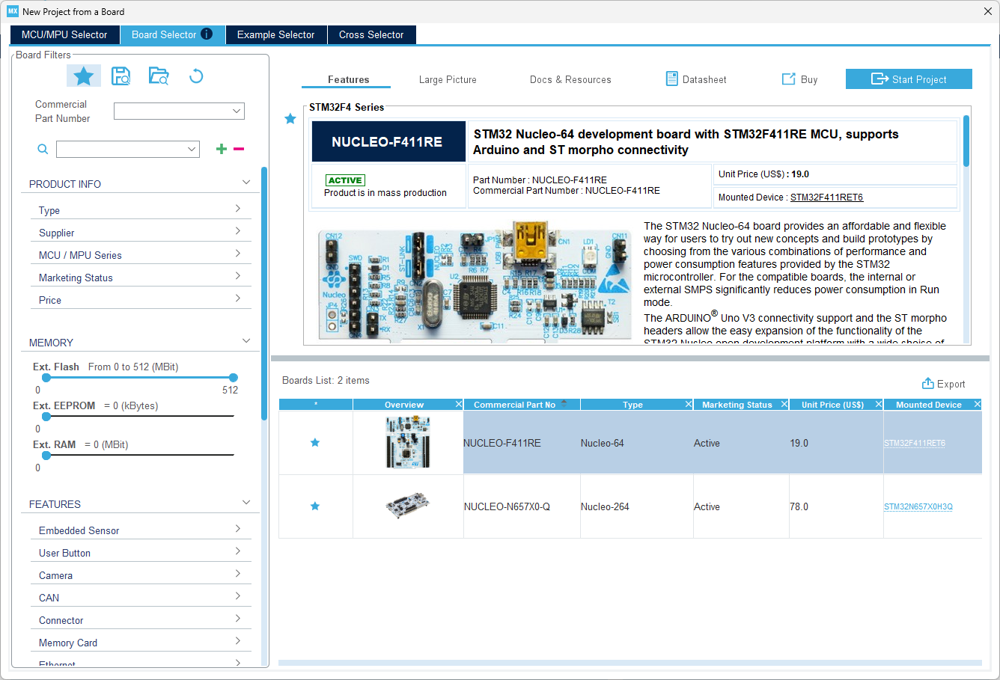 <br>
 <br>
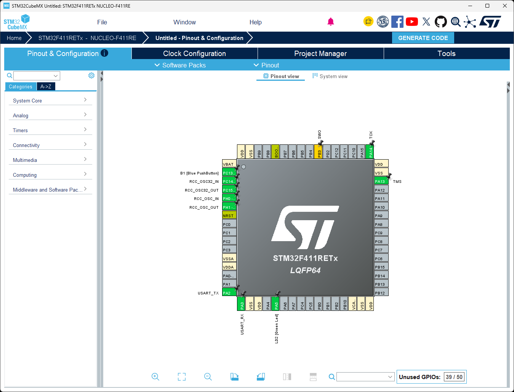 <br>
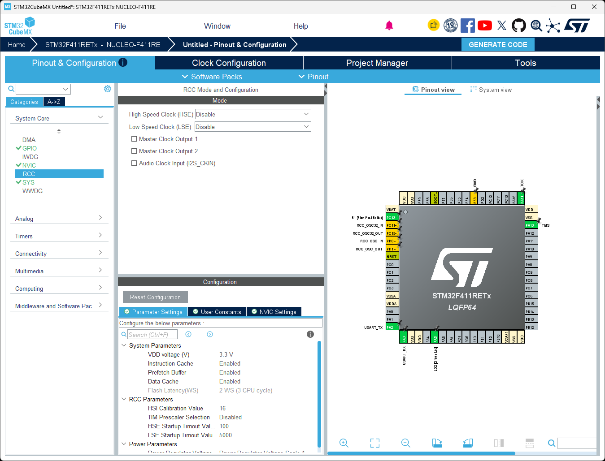 <br>
 <br>
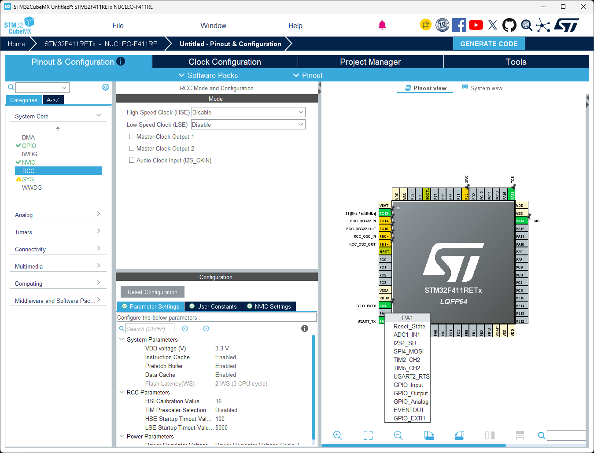 <br>
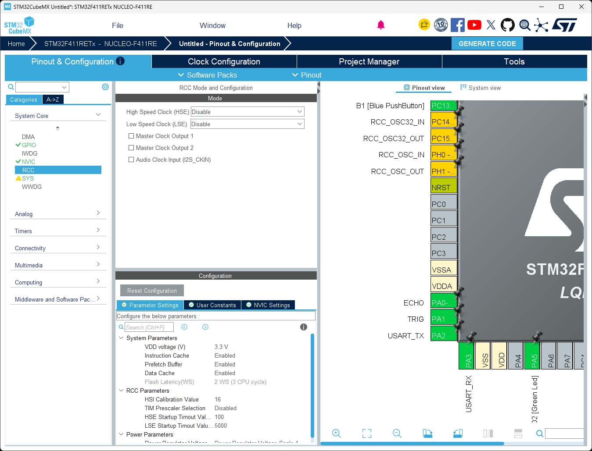 <br>
 <br>
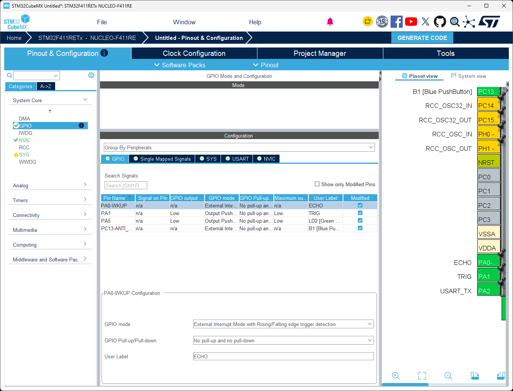 <br>
 <br>
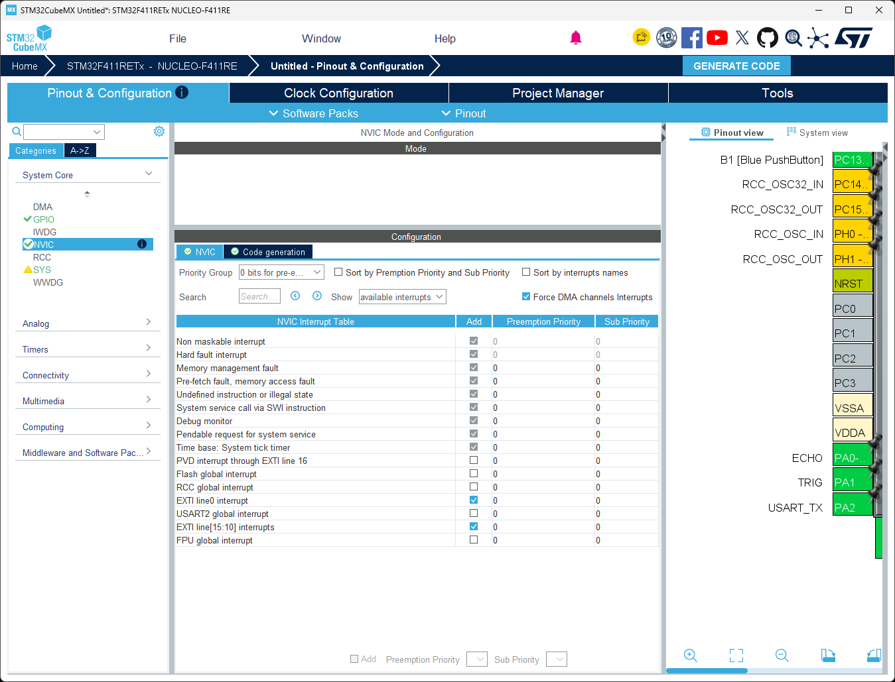 <br>
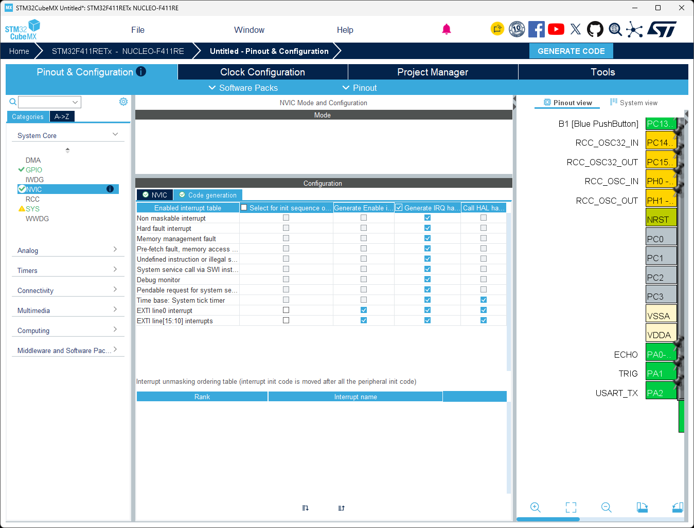 <br>
 <br>
 <br>
 <br>
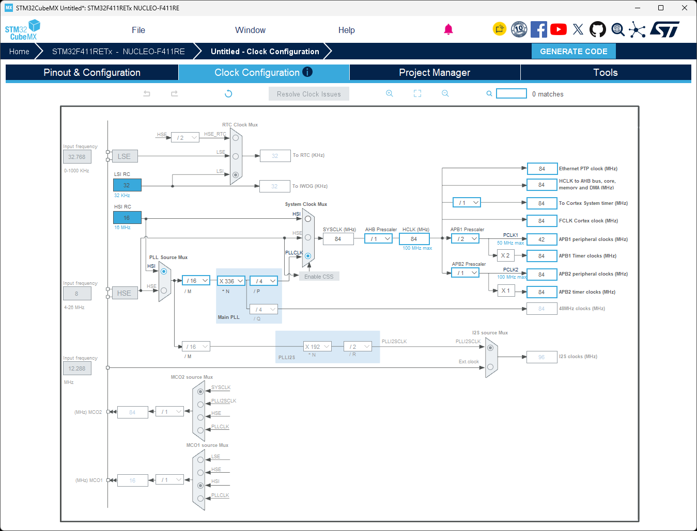 <br>

* F411_LAB

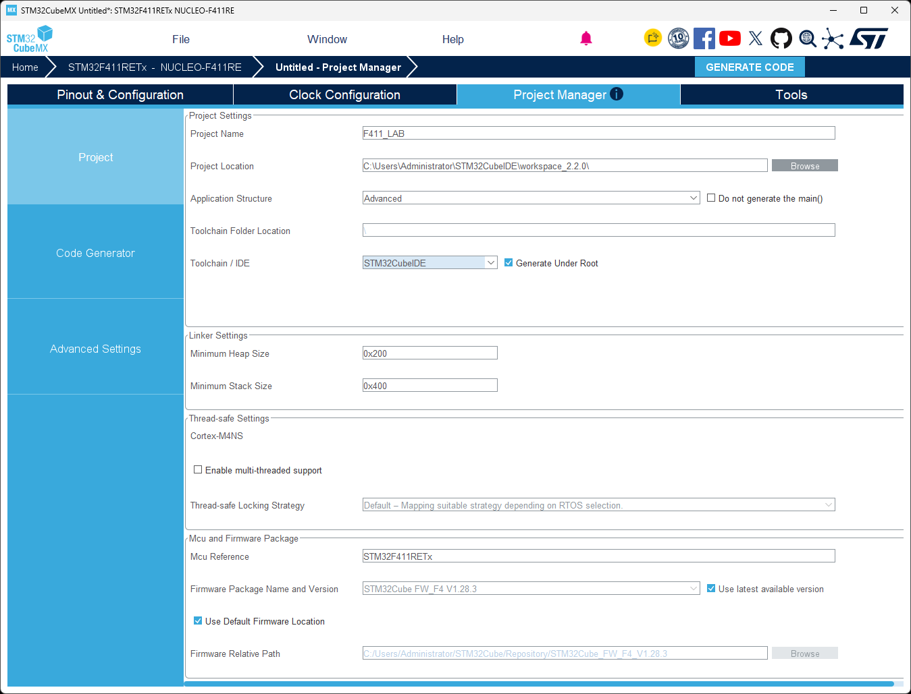 <br>
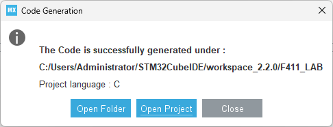 <br>
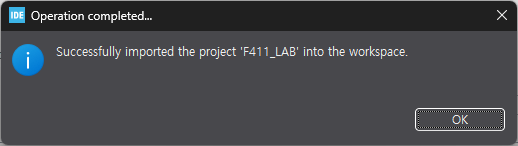 <br>
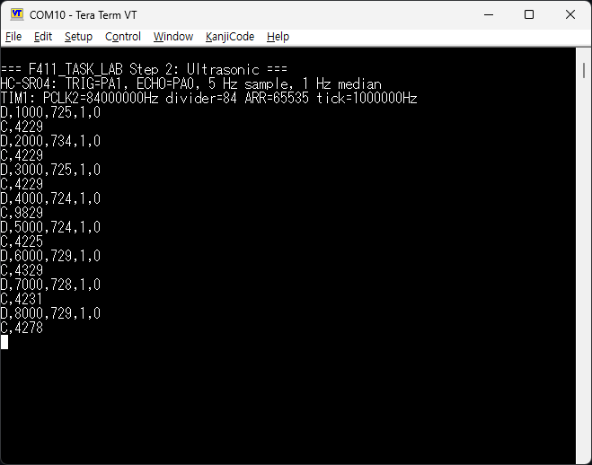 <br>

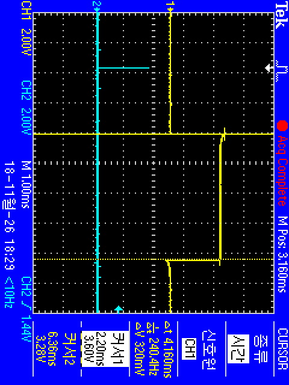 <br>
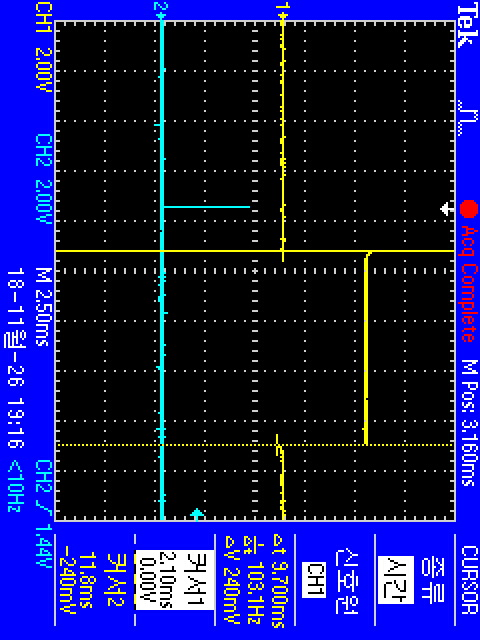 <br>

## 4. 코드 수정 상세

###  4.1 ultrasonic.h : API

```c
#ifndef ULTRASONIC_H
#define ULTRASONIC_H

#ifdef __cplusplus
extern "C" {
#endif

#include <stdint.h>
#include "stm32f4xx_hal.h"

typedef struct
{
  uint32_t timestamp_ms;
  uint32_t errors;
  uint16_t distance_ref_mm;
  uint16_t distance_mm;
  uint8_t valid;
} Ultrasonic_Result;

extern volatile uint16_t g_trace_echo_ticks;
extern volatile uint8_t g_trace_echo_edge;
extern volatile uint8_t g_trace_echo_state;
extern volatile uint32_t g_trace_edge_count;

void Ultrasonic_Init(void);
void Ultrasonic_Task(void);
uint8_t Ultrasonic_GetResult(Ultrasonic_Result *result);
uint16_t Ultrasonic_GetLastEchoTicks(void);
uint8_t Ultrasonic_IsIdle(void);
void Ultrasonic_SetSoundSpeedX10(uint16_t speed_x10);
void Ultrasonic_OnEchoEdge(void);

#ifdef __cplusplus
}
#endif

#endif

```


### 4.2 `ultrasonic.c` - 거리 계산 핵심

```c
#define US_TIMER_TICKS_PER_US 1U
#define US_MIN_ECHO_TICKS (100U * US_TIMER_TICKS_PER_US)
#define US_MAX_ECHO_TICKS (30000U * US_TIMER_TICKS_PER_US)
```

```c
uint16_t Ultrasonic_GetLastEchoTicks(void)
{
  return s_echoWidthTicks;
}
```

```c
static void US_StoreSample(uint32_t width_ticks)
{
  uint32_t width_us = width_ticks / US_TIMER_TICKS_PER_US;
  uint32_t distance_ref_mm = (width_us * US_REFERENCE_SOUND_SPEED_X10) / 20000U;
  uint32_t distance_mm = (width_us * s_soundSpeedX10) / 20000U;
  ...
}
```

- `US_REFERENCE_SOUND_SPEED_X10 = 3430`은 343.0 m/s입니다.
- `/20000`은 mm/us로 환산한 뒤 왕복 시간을 2로 나누는 부분입니다.
- `width = (uint16_t)(fall_cnt - rise_cnt)`이므로 TIM1 16-bit 오버플로도 처리됩니다.

#### 전체코드

```c
#include "ultrasonic.h"
#include "main.h"

extern TIM_HandleTypeDef htim1;

#define US_SAMPLE_PERIOD_MS 200U
#define US_PUBLISH_PERIOD_MS 1000U
#define US_ECHO_TIMEOUT_MS 35U
#define US_TRIG_PULSE_US 10U
#define US_TIMER_TICKS_PER_US 1U
#define US_MIN_ECHO_TICKS (100U * US_TIMER_TICKS_PER_US)
#define US_MAX_ECHO_TICKS (30000U * US_TIMER_TICKS_PER_US)
#define US_MIN_DISTANCE_MM 20U
#define US_MAX_DISTANCE_MM 4000U
#define US_FILTER_SIZE 5U
#define US_REFERENCE_SOUND_SPEED_X10 3430U
#define US_DEFAULT_SOUND_SPEED_X10 US_REFERENCE_SOUND_SPEED_X10
#define US_MIN_SOUND_SPEED_X10 2500U
#define US_MAX_SOUND_SPEED_X10 4000U

typedef enum
{
  US_STATE_IDLE = 0,
  US_STATE_WAIT_ECHO
} Ultrasonic_State;

static TIM_HandleTypeDef *s_htim;
static volatile Ultrasonic_State s_state;
static uint32_t s_lastSampleTick;
static uint32_t s_lastPublishTick;
static uint32_t s_echoStartTick;
static uint16_t s_echoStartCnt;
static volatile uint16_t s_echoWidthTicks;
static volatile uint8_t s_echoRising;
static volatile uint8_t s_echoDone;
static uint16_t s_samplesRef[US_FILTER_SIZE];
static uint16_t s_samplesCorr[US_FILTER_SIZE];
static uint8_t s_sampleCount;
static uint8_t s_sampleIndex;
static uint32_t s_errorCount;
static uint16_t s_soundSpeedX10;
static Ultrasonic_Result s_result;
static volatile uint8_t s_resultReady;

static uint16_t US_GetCounter(void);
static void US_StoreSample(uint32_t width_ticks);
static uint16_t US_Median(const uint16_t *samples);
static void US_Publish(uint32_t now);

static uint16_t US_GetCounter(void)
{
  return (uint16_t)__HAL_TIM_GET_COUNTER(s_htim);
}

void Ultrasonic_Init(void)
{
  s_htim = &htim1;
  HAL_GPIO_WritePin(TRIG_GPIO_Port, TRIG_Pin, GPIO_PIN_RESET);

  if (HAL_TIM_Base_Start(s_htim) != HAL_OK)
  {
    Error_Handler();
  }

  s_state = US_STATE_IDLE;
  s_lastSampleTick = HAL_GetTick();
  s_lastPublishTick = s_lastSampleTick;
  s_echoStartTick = 0U;
  s_echoStartCnt = 0U;
  s_echoWidthTicks = 0U;
  s_echoRising = 0U;
  s_echoDone = 0U;
  s_sampleCount = 0U;
  s_sampleIndex = 0U;
  s_errorCount = 0U;
  s_soundSpeedX10 = US_DEFAULT_SOUND_SPEED_X10;
  s_resultReady = 0U;
  s_result.timestamp_ms = 0U;
  s_result.distance_ref_mm = 0U;
  s_result.distance_mm = 0U;
  s_result.valid = 0U;
  s_result.errors = 0U;
}

void Ultrasonic_Task(void)
{
  uint32_t now;
  uint16_t trigStartCnt;

  if (s_htim == NULL)
  {
    return;
  }

  now = HAL_GetTick();

  switch (s_state)
  {
    case US_STATE_IDLE:
      if ((now - s_lastSampleTick) >= US_SAMPLE_PERIOD_MS)
      {
        s_lastSampleTick = now;
        s_echoRising = 0U;
        s_echoDone = 0U;

        trigStartCnt = US_GetCounter();
        HAL_GPIO_WritePin(TRIG_GPIO_Port, TRIG_Pin, GPIO_PIN_SET);
        while ((uint16_t)(US_GetCounter() - trigStartCnt) < US_TRIG_PULSE_US)
        {
        }
        HAL_GPIO_WritePin(TRIG_GPIO_Port, TRIG_Pin, GPIO_PIN_RESET);

        s_echoStartTick = now;
        s_state = US_STATE_WAIT_ECHO;
      }
      break;

    case US_STATE_WAIT_ECHO:
      if (s_echoDone != 0U)
      {
        if (s_echoDone == 1U)
        {
          US_StoreSample(s_echoWidthTicks);
        }
        else
        {
          s_errorCount++;
        }
        s_echoDone = 0U;
        s_state = US_STATE_IDLE;
      }
      else if ((now - s_echoStartTick) >= US_ECHO_TIMEOUT_MS)
      {
        s_errorCount++;
        s_state = US_STATE_IDLE;
      }
      break;

    default:
      s_state = US_STATE_IDLE;
      break;
  }

  if ((now - s_lastPublishTick) >= US_PUBLISH_PERIOD_MS)
  {
    s_lastPublishTick = now;
    US_Publish(now);
  }
}

uint8_t Ultrasonic_GetResult(Ultrasonic_Result *result)
{
  if ((result == NULL) || (s_resultReady == 0U))
  {
    return 0U;
  }

  *result = s_result;
  s_resultReady = 0U;
  return 1U;
}

uint8_t Ultrasonic_IsIdle(void)
{
  return (s_state == US_STATE_IDLE) ? 1U : 0U;
}

void Ultrasonic_SetSoundSpeedX10(uint16_t speed_x10)
{
  if ((speed_x10 >= US_MIN_SOUND_SPEED_X10) && (speed_x10 <= US_MAX_SOUND_SPEED_X10))
  {
    s_soundSpeedX10 = speed_x10;
  }
}

uint16_t Ultrasonic_GetLastEchoTicks(void)
{
  return s_echoWidthTicks;
}

void Ultrasonic_OnEchoEdge(void)
{
  uint16_t now;
  uint16_t width;

  if (s_htim == NULL)
  {
    return;
  }

  now = US_GetCounter();

  if (HAL_GPIO_ReadPin(ECHO_GPIO_Port, ECHO_Pin) == GPIO_PIN_SET)
  {
    if ((s_state == US_STATE_WAIT_ECHO) && (s_echoRising == 0U))
    {
      s_echoStartCnt = now;
      s_echoRising = 1U;
    }
  }
  else if (s_echoRising != 0U)
  {
    width = (uint16_t)(now - s_echoStartCnt);
    s_echoRising = 0U;
    s_echoWidthTicks = width;

    if ((width >= US_MIN_ECHO_TICKS) && (width <= US_MAX_ECHO_TICKS))
    {
      s_echoDone = 1U;
    }
    else
    {
      s_echoDone = 2U;
    }
  }
}

static void US_StoreSample(uint32_t width_ticks)
{
  uint32_t width_us = width_ticks / US_TIMER_TICKS_PER_US;
  uint32_t distance_ref_mm = (width_us * US_REFERENCE_SOUND_SPEED_X10) / 20000U;
  uint32_t distance_mm = (width_us * s_soundSpeedX10) / 20000U;

  if ((distance_mm >= US_MIN_DISTANCE_MM) && (distance_mm <= US_MAX_DISTANCE_MM))
  {
    s_samplesRef[s_sampleIndex] = (uint16_t)distance_ref_mm;
    s_samplesCorr[s_sampleIndex] = (uint16_t)distance_mm;
    s_sampleIndex = (uint8_t)((s_sampleIndex + 1U) % US_FILTER_SIZE);
    if (s_sampleCount < US_FILTER_SIZE)
    {
      s_sampleCount++;
    }
  }
  else
  {
    s_errorCount++;
  }
}

static uint16_t US_Median(const uint16_t *samples)
{
  uint16_t sorted[US_FILTER_SIZE];
  uint8_t i;
  uint8_t j;

  for (i = 0U; i < s_sampleCount; i++)
  {
    sorted[i] = samples[i];
  }

  for (i = 0U; (uint8_t)(i + 1U) < s_sampleCount; i++)
  {
    for (j = (uint8_t)(i + 1U); j < s_sampleCount; j++)
    {
      if (sorted[j] < sorted[i])
      {
        uint16_t temp = sorted[i];
        sorted[i] = sorted[j];
        sorted[j] = temp;
      }
    }
  }

  return sorted[s_sampleCount / 2U];
}

static void US_Publish(uint32_t now)
{
  s_result.timestamp_ms = now;

  if (s_sampleCount > 0U)
  {
    s_result.distance_ref_mm = US_Median(s_samplesRef);
    s_result.distance_mm = US_Median(s_samplesCorr);
    s_result.valid = 1U;
  }
  else
  {
    s_result.distance_ref_mm = 0U;
    s_result.distance_mm = 0U;
    s_result.valid = 0U;
  }

  s_result.errors = s_errorCount;
  s_resultReady = 1U;

  s_sampleCount = 0U;
  s_sampleIndex = 0U;
}
```

### 4.3 `main.c` - EXTI 콜백 분기

```c
/* USER CODE BEGIN 4 */
void HAL_GPIO_EXTI_Callback(uint16_t GPIO_Pin)
{
  if (GPIO_Pin == ECHO_Pin)
  {
    Ultrasonic_OnEchoEdge();
  }
  else if (GPIO_Pin == B1_Pin)
  {
    HAL_GPIO_TogglePin(LD2_GPIO_Port, LD2_Pin);
  }
}
/* USER CODE END 4 */
```

#### 전체코드

```c
/* USER CODE BEGIN Includes */
#include <stdio.h>
#include "ultrasonic.h"
/* USER CODE END Includes */
```

```c
/* USER CODE BEGIN 0 */
#ifdef __GNUC__
#define PUTCHAR_PROTOTYPE int __io_putchar(int ch)
#else
#define PUTCHAR_PROTOTYPE int fputc(int ch, FILE *f)
#endif

PUTCHAR_PROTOTYPE
{
  if (ch == '\n')
  {
    HAL_UART_Transmit(&huart2, (uint8_t *)"\r", 1, 0xFFFF);
  }
  HAL_UART_Transmit(&huart2, (uint8_t *)&ch, 1, 0xFFFF);

  return ch;
}

static void Sensor_Task(void)
{
  Ultrasonic_Result result;
  char line[80];

  Ultrasonic_Task();

  if (Ultrasonic_GetResult(&result) != 0U)
  {
    (void)snprintf(line, sizeof(line), "D,%lu,%u,%u,%lu\n",
                   (unsigned long)result.timestamp_ms,
                   (unsigned int)result.distance_mm,
                   (unsigned int)result.valid,
                   (unsigned long)result.errors);
    printf("%s", line);
    printf("C,%u\n", (unsigned int)Ultrasonic_GetLastEchoTicks());
  }
}
/* USER CODE END 0 */
```

```c
  /* USER CODE BEGIN 2 */
  Ultrasonic_Init();
  printf("\n=== F411_TASK_LAB Step 2: Ultrasonic ===\n");
  printf("HC-SR04: TRIG=PA1, ECHO=PA0, 5 Hz sample, 1 Hz median\n");
  printf("TIM1: PCLK2=%luHz divider=%lu ARR=%lu tick=%luHz\n",
         (unsigned long)HAL_RCC_GetPCLK2Freq(),
         (unsigned long)(htim1.Init.Prescaler + 1U),
         (unsigned long)htim1.Init.Period,
         (unsigned long)(HAL_RCC_GetPCLK2Freq() / (htim1.Init.Prescaler + 1U)));
  /* USER CODE END 2 */
```

```c
  /* Infinite loop */
  /* USER CODE BEGIN WHILE */
  while (1)
  {
    /* USER CODE END WHILE */

    /* USER CODE BEGIN 3 */
    Sensor_Task();
  }
  /* USER CODE END 3 */
```

```c
/* USER CODE BEGIN 4 */
void HAL_GPIO_EXTI_Callback(uint16_t GPIO_Pin)
{
  if (GPIO_Pin == ECHO_Pin)
  {
    Ultrasonic_OnEchoEdge();
  }
  else if (GPIO_Pin == B1_Pin)
  {
    HAL_GPIO_TogglePin(LD2_GPIO_Port, LD2_Pin);
  }
}
/* USER CODE END 4 */
```

### 4.4 `stm32f4xx_it.c` / `stm32f4xx_it.h`

```c
void EXTI0_IRQHandler(void)
{
  HAL_GPIO_EXTI_IRQHandler(ECHO_Pin);
}

void EXTI15_10_IRQHandler(void)
{
  HAL_GPIO_EXTI_IRQHandler(B1_Pin);
}
```

```c
void EXTI0_IRQHandler(void);
void EXTI15_10_IRQHandler(void);
```

#### 전체코드

```c
/**
  * @brief This function handles EXTI line0 interrupt.
  */
void EXTI0_IRQHandler(void)
{
  /* USER CODE BEGIN EXTI0_IRQn 0 */

  /* USER CODE END EXTI0_IRQn 0 */
  HAL_GPIO_EXTI_IRQHandler(ECHO_Pin);
  /* USER CODE BEGIN EXTI0_IRQn 1 */

  /* USER CODE END EXTI0_IRQn 1 */
}

/* USER CODE BEGIN 1 */
void EXTI15_10_IRQHandler(void)
{
  HAL_GPIO_EXTI_IRQHandler(B1_Pin);
}
/* USER CODE END 1 */
```

## 5. 시리얼 출력 형식

부팅 직후 배너 예시:

```text
=== F411_TASK_LAB Step 2: Ultrasonic ===
HC-SR04: TRIG=PA1, ECHO=PA0, 5 Hz sample, 1 Hz median
TIM1: PCLK2=84000000Hz divider=84 ARR=65535 tick=1000000Hz
```

1초마다 아래 두 줄이 출력됩니다.

```text
D,58123,1681,1,0
C,9801
```

| 필드 | 의미 |
|---|---|
| `D` | `timestamp_ms`, `distance_mm`, `valid`, `errors` |
| `C` | 마지막 ECHO 펄스의 TIM1 카운트 차이. 검증용 디버그 출력 |

검증이 끝나면 `printf("C,%u\n", ...)` 한 줄만 제거하고 `D,` 라인만 남겨도 됩니다.

## 6. 측정 흐름

1. 200 ms마다 TRIG(PA1)를 10 us 동안 HIGH로 유지합니다.
2. ECHO(PA0) Rising 인터럽트에서 `TIM1->CNT`를 저장합니다.
3. ECHO Falling 인터럽트에서 `TIM1->CNT`를 저장합니다.
4. `(uint16_t)(fall - rise)`로 펄스 폭(ticks)을 구합니다.
5. 유효 범위(100~30000 us)이면 거리 샘플로 저장합니다.
6. 5개 샘플의 중앙값을 계산해 1초마다 UART2로 publish합니다.
7. B1 버튼을 누르면 같은 EXTI 콜백에서 LD2를 토글합니다.

## 7. 실험 결과와 분석

| 조건 | 스코프로 본 ECHO 폭 | `C` 카운트 | 계산 거리 | 판정 |
|---|---:|---:|---:|---|
| 15 cm 자 | 약 1.0 ms | 약 1000 | 171 mm | 근접 기준점/반올림 오차 고려 시 정상. 이론값은 0.875 ms |
| 최초 1.5 m 기대 | 4.16 ms | 약 4160~4222 | 713~724 mm | 계산은 맞음. 센서가 더 가까운 면을 보고 있었음 |
| 각도 조정 후 | 약 9.7 ms | 약 9700 | 1664 mm | 1.7~1.8 m 기대와 일치 |
| 최종 UART 값 | 약 9.80 ms | 약 9801 | **1681 mm** | 정상 측정으로 확정 |

계산 예시:

```text
9.7 ms  → 9700 × 3430 / 20000 = 1663.55 mm
4.16 ms → 4160 × 3430 / 20000 =  713.44 mm
1.0 ms  → 1000 × 3430 / 20000 =  171.50 mm
1681 mm → 1681 × 20000 / 3430 ≈ 9801 ticks
```

### conclusion

- 거리 공식과 TIM1 설정은 수정할 필요가 없었습니다.
- 4.16 ms는 실제 1.5 m 거리가 아니라 약 0.71 m 지점의 반사면을 잡은 결과였습니다.
- HC-SR04는 빔 각도가 좁고 반사면에 민감합니다. 수직이 조금만 어긋나도 옆/아래의 다른 물체를 측정합니다.
- 센서를 각도 조정해 타겟 면에 정확히 마주하게 한 뒤 9.7 ms, 1681 mm가 나와 계산식이 검증되었습니다.
- 음속은 온도에 따라 변하지만(약 0.17 %/°C) 이번 차이처럼 2배 수준의 오차는 만들지 못합니다.

## 8. 주의사항

- `HAL_GPIO_EXTI_Callback()`은 모든 GPIO EXTI가 공유하므로 반드시 `GPIO_Pin`을 확인해야 합니다.
- TIM1은 16-bit 카운터이므로 `uint16_t` 뺄셈으로 오버플로를 처리합니다.
- B1은 하드웨어 디바운스가 없어 여러 번 인터럽트가 발생할 수 있습니다.
- HC-SR04는 약 2 cm 이하 근거리에서 측정이 불안정할 수 있습니다.
- CubeMX에서 코드를 다시 생성해도 `USER CODE BEGIN/END` 영역의 호출과 콜백은 유지됩니다.

----

## 9. SWV / 트레이스 관찰 설정

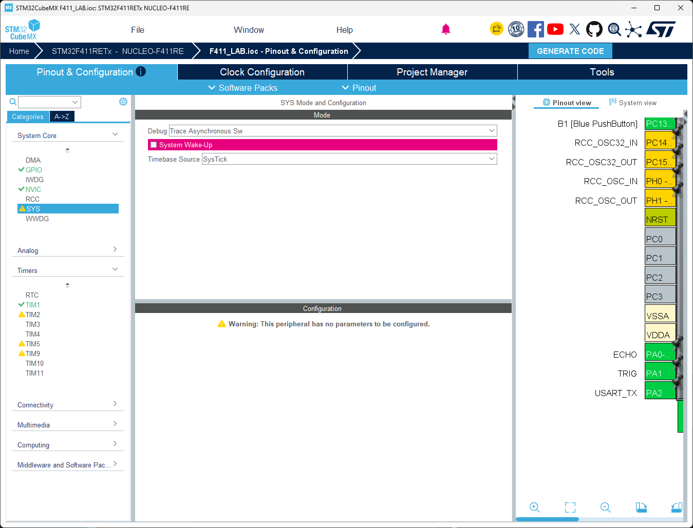 <br>

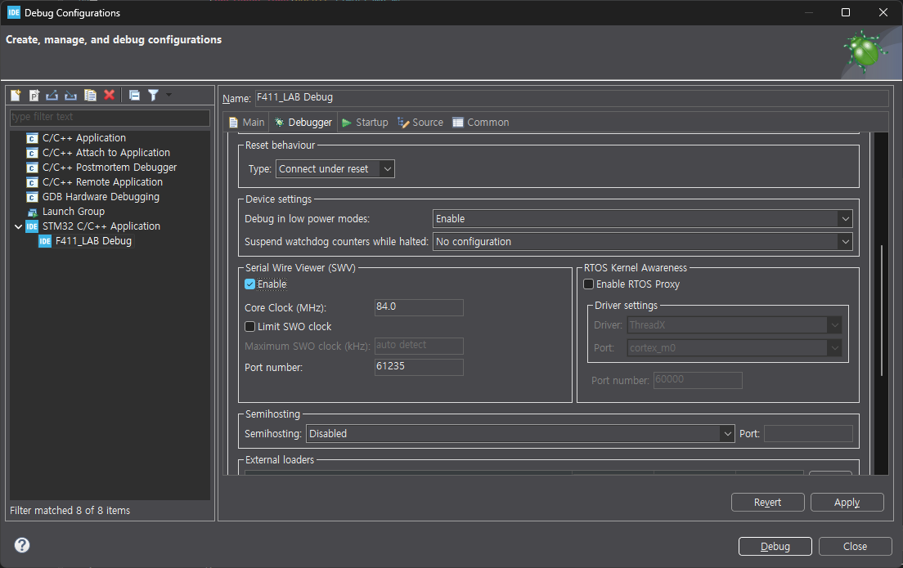 <br>
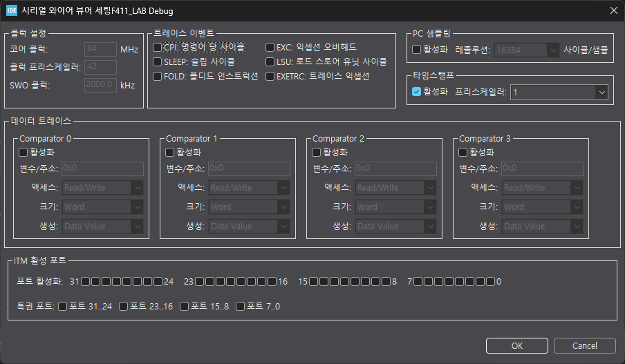 <br>
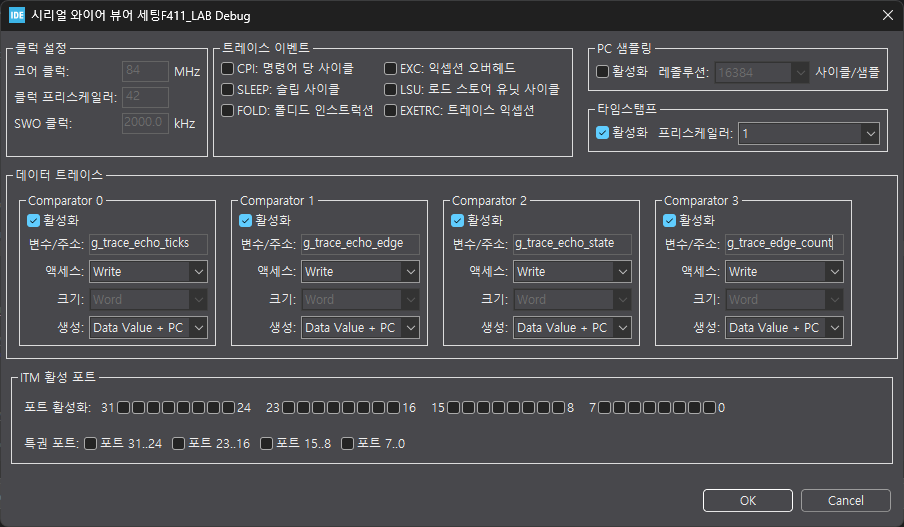 <br>
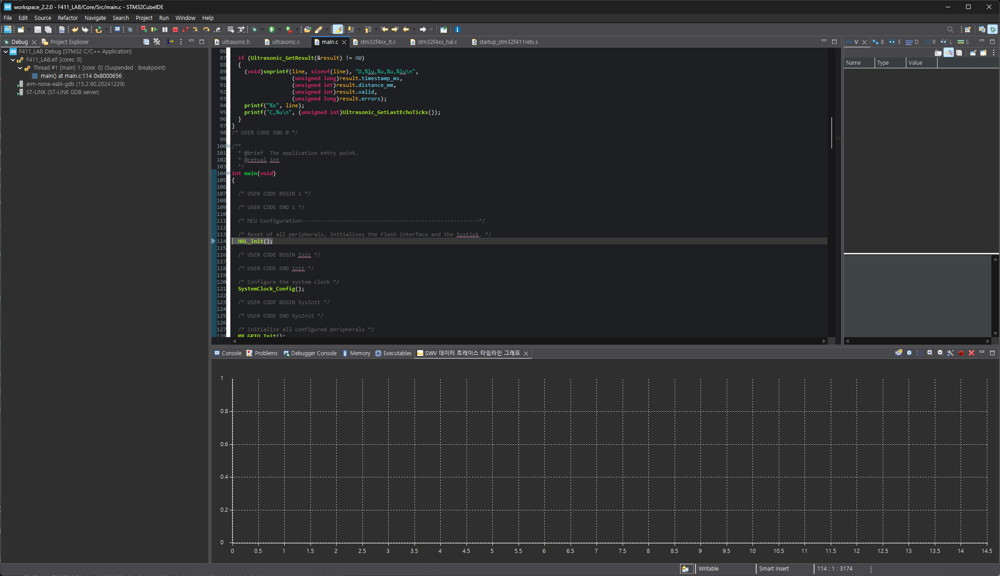 <br>
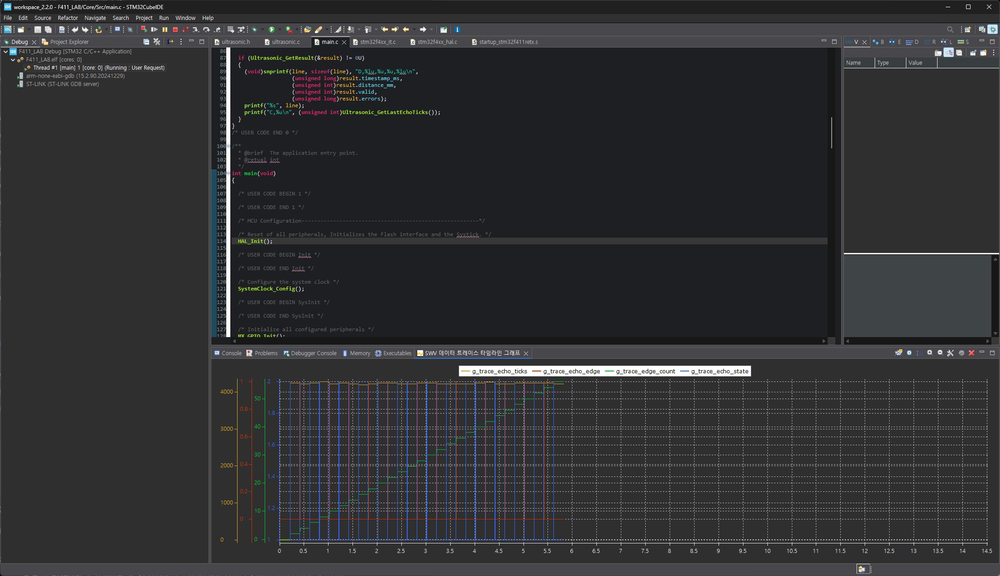 <br>


CubeMX에서 `SYS → Debug = Trace Asynchronous SW`를 선택하면 `PA13=SWDIO`, `PA14=SWCLK`, `PB3=SWO`가 할당됩니다.

```properties
PA13.Mode=Trace_Asynchronous_SW
PA14.Mode=Trace_Asynchronous_SW
PB3.Mode=Trace_Asynchronous_SW
PB3.Signal=SYS_JTDO-SWO
```

Debug Configuration에서는 다음을 확인합니다.

- `Debugger → Serial Wire Viewer` 활성화 (`enable_swv=true`)
- `swd_mode=true`
- `swv_trace_hclk=84000000` (SYSCLK 84 MHz)
- `swv_port=61235` (기본값)

디버그 실행 후 `Window → Show View → SWV`에서 다음 뷰를 엽니다.

| 뷰 | 설정 | 코드 수정 필요 여부 |
|---|---|---|
| `SWV Data Trace Timeline Graph` | 비교기에 `g_trace_echo_ticks`, `g_trace_echo_edge`, `g_trace_echo_state`, `g_trace_b1_irq` 추가 | 변수는 이미 추가되어 있음. 뷰에서 비교기 등록만 필요 |
| `SWV ITM Data Console` | Stimulus Port 0 활성화 후 Start Trace | UART `printf`는 여기 나오지 않음. ITM 출력은 `ITM_SendChar()` 별도 호출 필요 |
| `SWV Statistical Profiling` | Trace 시작 후 실행 | 불필요. 함수별 실행 시간/인터럽트 통계 표시 |

추가된 트레이스 변수:

| 변수 | 의미 |
|---|---|
| `g_trace_echo_ticks` | 마지막 ECHO 펄스 폭, TIM1 ticks (1 tick = 1 us) |
| `g_trace_echo_edge` | ECHO Rising에서 1, Falling/Timeout에서 0 |
| `g_trace_echo_state` | 0=Idle/Echo Low, 1=ECHO Rising 검출, 2=TRIG 후 대기 |
| `g_trace_edge_count` | ECHO 에지 발생 횟수 |
| `g_trace_b1_irq` | `EXTI15_10_IRQHandler()` 진입마다 토글 |
| `g_trace_b1_irq_count` | B1 EXTI 인터럽트 진입 횟수 |


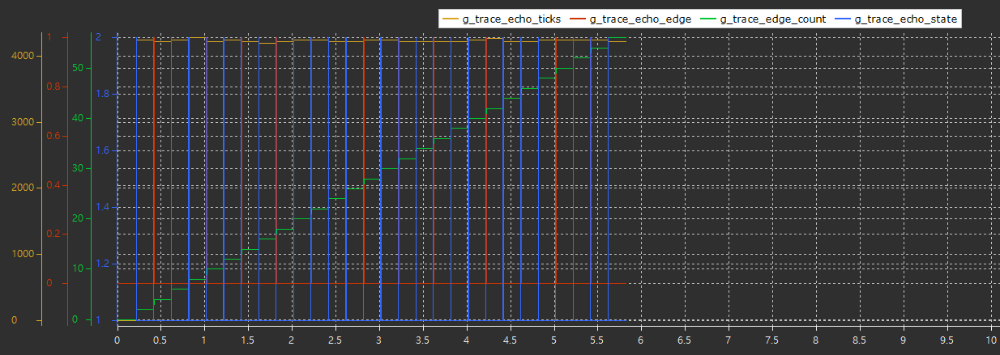 <br>
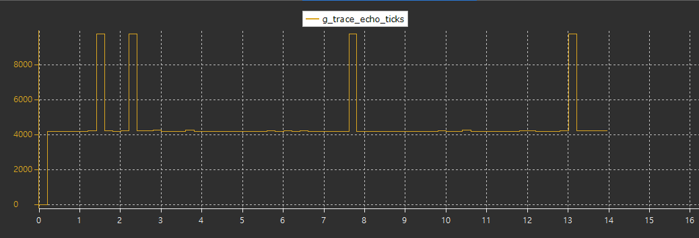 <br>
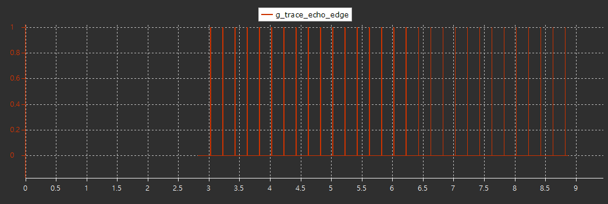 <br>
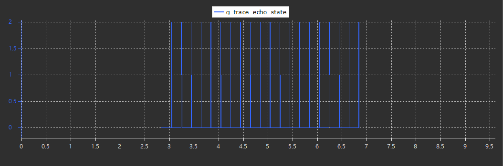 <br>
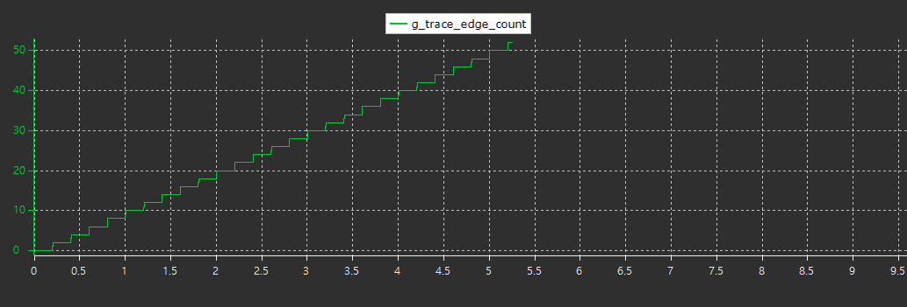 <br>
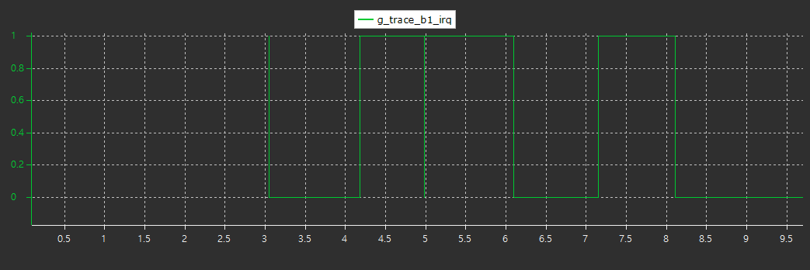 <br>

### 8.1 비교기 등록 절차

Debugger 탭에서 `Debug probe=ST-LINK`, `Interface=SWD`, `Freq=Auto`, `SWV=Enable`이 보이면 설정은 정상입니다. Comparator 등록은 Debug Configuration이 아니라 **디버그 실행 후 SWV 뷰**에서 합니다.

1. Debug를 실행해 `main()`에서 멈춘 상태로 둡니다.
2. `Window → Show View → SWV → SWV Data Trace Timeline Graph`를 엽니다. 목록에 없으면 `Other… → SWV`를 선택합니다. `SWV Data Trace`, `SWV Trace Log`도 함께 열면 숫자 기록을 보기 좋습니다.
3. SWV 탭 오른쪽 위의 렌치/톱니 아이콘(`Configure Trace` 또는 `SWV Settings`)을 클릭합니다.
4. `Comparator 0~3`에서 `Enable`을 체크하고 변수를 등록합니다. 비교기는 최대 4개까지만 사용할 수 있습니다.

| Comparator | Var/Addr | Access | Generate |
|---|---|---|---|
| 0 | `g_trace_echo_ticks` | `Write` | `Data Value + PC` |
| 1 | `g_trace_echo_edge` | `Write` | `Data Value + PC` |
| 2 | `g_trace_echo_state` | `Write` | `Data Value + PC` |
| 3 | `g_trace_edge_count` | `Write` | `Data Value + PC` |

5. OK를 누른 뒤 SWV 뷰의 빨간 **Start Trace** 버튼을 먼저 누르고, 그다음 **Resume(F8)** 합니다.
6. `SWV Data Trace`의 Watch에서 행을 클릭하면 해당 comparator의 History가 표시됩니다. Timeline Graph에서는 표시할 comparator 체크도 켜야 선이 보입니다.

변수 이름이 해석되지 않으면 현재 ELF의 심볼 주소를 `Var/Addr`에 넣을 수 있습니다. 빌드 후에는 주소가 바뀔 수 있으므로 이름을 먼저 사용합니다.

| 변수 | 주소 | 크기 |
|---|---|---:|
| `g_trace_b1_irq` | `0x20000114` | 1 byte |
| `g_trace_b1_irq_count` | `0x20000118` | 4 bytes |
| `g_trace_echo_ticks` | `0x20000120` | 2 bytes |
| `g_trace_echo_edge` | `0x20000122` | 1 byte |
| `g_trace_echo_state` | `0x20000123` | 1 byte |
| `g_trace_edge_count` | `0x20000124` | 4 bytes |

Statistical Profiling은 comparators 등록 없이 트레이스만 켜면 `EXTI0_IRQHandler()`, `EXTI15_10_IRQHandler()`, `Ultrasonic_OnEchoEdge()` 같은 함수 통계를 보여줍니다.

### 8.2 Data Trace 결과 읽는 법

실제 저장된 `SWV 데이터 트레이스.txt`의 한 줄 예시:

```text
"쓰기";"4196";"0x8001064";"10792159";"128.478083 ms"
```

| 필드 | 의미 |
|---|---|
| `쓰기` | DWT comparator가 잡은 접근 종류. `Access=Write`이므로 CPU가 변수에 값을 쓸 때마다 기록됨 |
| `4196` | 기록 순간 `g_trace_echo_ticks`에 써진 값. TIM1이 1 MHz이므로 `4196 ticks = 4196 us` |
| `0x8001064` | 값을 쓴 코드의 PC 주소. 변수 주소가 아님. `addr2line` 결과는 `ultrasonic.c:221`, 즉 `g_trace_echo_ticks = width;` |
| `10792159` | 이벤트 시점의 DWT 사이클 카운터 |
| `128.478083 ms` | 같은 시점의 시간. `10,792,159 / 84,000,000 ≈ 0.128478 s`로 Core Clock 84 MHz 설정도 확인됨 |

거리 환산 예:

```text
4196 × 3430 / 20000 ≈ 719.6 mm
4225 × 3430 / 20000 ≈ 724.6 mm
4174 × 3430 / 20000 ≈ 715.8 mm
4145 × 3430 / 20000 ≈ 710.9 mm
```

### 8.3 Watch 변수 동작과 실제 흐름

| 변수 | 관측된 값 | 동작 |
|---|---:|---|
| `g_trace_echo_ticks` | `4225` | Falling 에지에서 `(uint16_t)(now - s_echoStartCnt)`로 계산한 ECHO 펄스 폭을 저장 (`ultrasonic.c:221`) |
| `g_trace_echo_edge` | `0` | ECHO가 HIGH이면 `1`, LOW이면 `0`. Rising에서 `1` (`ultrasonic.c:211`), Falling/Timeout에서 `0` (`:222`, `:146`) |
| `g_trace_echo_state` | `1` | `2`=TRIG 후 대기, `1`=ECHO Rising 검출, `0`=Idle/ECHO Low. TRIG 후 `2` (`:124`), Rising에서 `1` (`:212`), Falling에서 `0` (`:223`) |
| `g_trace_edge_count` | `620` | 유효 ECHO Rising/Falling마다 1씩 증가 (`:213`, `:224`). Trace 시작 전부터 누적된 값이므로 현재 구간의 에지 수와 다를 수 있음 |

동작 순서:

1. 200 ms마다 `TRIG(PA1)`를 10 us 동안 HIGH → LOW로 만들고 `g_trace_echo_state=2`로 둡니다.
2. HC-SR04의 ECHO가 HIGH가 되면 `EXTI0_IRQHandler()` → `HAL_GPIO_EXTI_Callback()` → `Ultrasonic_OnEchoEdge()`가 호출됩니다.
3. Rising에서 TIM1 `CNT`를 `s_echoStartCnt`에 저장하고 `edge=1`, `state=1`, `edge_count++`를 수행합니다.
4. ECHO가 LOW가 되면 다시 `CNT`를 읽어 `width = now - start`를 구합니다.
5. `g_trace_echo_ticks = width;`가 실행될 때 History에 `쓰기` 이벤트가 남습니다. 이후 `edge=0`, `state=0`, `edge_count++`, `s_echoDone=1`이 됩니다.
6. `Ultrasonic_Task()`가 완료를 감지해 샘플을 저장하고, 1초마다 중앙값을 UART로 publish합니다.

실제 캡처 해석:

- History의 시간 간격이 `0.128 → 0.328 → 0.528 …`로 정확히 200 ms입니다. `US_SAMPLE_PERIOD_MS=200U`와 일치합니다.
- 값은 대부분 `4145~4225 ticks`, 즉 `4.145~4.225 ms`입니다. 이는 거리 약 `711~725 mm`이며 이전 스코프 측정값 `4.16 ms / 713 mm`와 일치합니다.
- `g_trace_echo_ticks`의 마지막 Watch 값 `4225`와 History 마지막 줄 `4225`가 같습니다.
- Watch의 4개 값은 같은 순간의 원자적 스냅샷이 아닙니다. comparator별 FIFO와 SWO 대역폭 때문에 `edge=0`, `state=1`처럼 섞여 보일 수 있으므로 정확한 타이밍은 각 변수의 History를 따로 봐야 합니다.
- Timeline Graph는 이미지로만 저장되지만, `SWV Data Trace`의 History는 텍스트/CSV로 저장할 수 있습니다. 이번에 저장한 `SWV_데이터_트레이스.txt`가 숫자 원본 데이터입니다.

### stm32f4xx_it.c

```c
/* USER CODE BEGIN PV */
volatile uint8_t g_trace_b1_irq;
volatile uint32_t g_trace_b1_irq_count;
/* USER CODE END PV */
```

```c
/**
  * @brief This function handles EXTI line0 interrupt.
  */
void EXTI0_IRQHandler(void)
{
  /* USER CODE BEGIN EXTI0_IRQn 0 */

  /* USER CODE END EXTI0_IRQn 0 */
  HAL_GPIO_EXTI_IRQHandler(ECHO_Pin);
  /* USER CODE BEGIN EXTI0_IRQn 1 */

  /* USER CODE END EXTI0_IRQn 1 */
}

/* USER CODE BEGIN 1 */
void EXTI15_10_IRQHandler(void)
{
  g_trace_b1_irq ^= 1U;
  g_trace_b1_irq_count++;
  HAL_GPIO_EXTI_IRQHandler(B1_Pin);
}
/* USER CODE END 1 */
```


### ultrasonic.c

```c
volatile uint16_t g_trace_echo_ticks;
volatile uint8_t g_trace_echo_edge;
volatile uint8_t g_trace_echo_state;
volatile uint32_t g_trace_edge_count;
```


```c
void Ultrasonic_Init(void)
{
  s_htim = &htim1;
  HAL_GPIO_WritePin(TRIG_GPIO_Port, TRIG_Pin, GPIO_PIN_RESET);

  if (HAL_TIM_Base_Start(s_htim) != HAL_OK)
  {
    Error_Handler();
  }

  s_state = US_STATE_IDLE;
  s_lastSampleTick = HAL_GetTick();
  s_lastPublishTick = s_lastSampleTick;
  s_echoStartTick = 0U;
  s_echoStartCnt = 0U;
  s_echoWidthTicks = 0U;
  s_echoRising = 0U;
  s_echoDone = 0U;
  s_sampleCount = 0U;
  s_sampleIndex = 0U;
  s_errorCount = 0U;
  s_soundSpeedX10 = US_DEFAULT_SOUND_SPEED_X10;
  s_resultReady = 0U;
  s_result.timestamp_ms = 0U;
  s_result.distance_ref_mm = 0U;
  s_result.distance_mm = 0U;
  s_result.valid = 0U;
  s_result.errors = 0U;
  g_trace_echo_ticks = 0U;
  g_trace_echo_edge = 0U;
  g_trace_echo_state = 0U;
  g_trace_edge_count = 0U;
}
```

```c
void Ultrasonic_Task(void)
{
  uint32_t now;
  uint16_t trigStartCnt;

  if (s_htim == NULL)
  {
    return;
  }

  now = HAL_GetTick();

  switch (s_state)
  {
    case US_STATE_IDLE:
      if ((now - s_lastSampleTick) >= US_SAMPLE_PERIOD_MS)
      {
        s_lastSampleTick = now;
        s_echoRising = 0U;
        s_echoDone = 0U;

        trigStartCnt = US_GetCounter();
        HAL_GPIO_WritePin(TRIG_GPIO_Port, TRIG_Pin, GPIO_PIN_SET);
        while ((uint16_t)(US_GetCounter() - trigStartCnt) < US_TRIG_PULSE_US)
        {
        }
        HAL_GPIO_WritePin(TRIG_GPIO_Port, TRIG_Pin, GPIO_PIN_RESET);

        s_echoStartTick = now;
        s_state = US_STATE_WAIT_ECHO;
        g_trace_echo_state = 2U;
      }
      break;

    case US_STATE_WAIT_ECHO:
      if (s_echoDone != 0U)
      {
        if (s_echoDone == 1U)
        {
          US_StoreSample(s_echoWidthTicks);
        }
        else
        {
          s_errorCount++;
        }
        s_echoDone = 0U;
        s_state = US_STATE_IDLE;
      }
      else if ((now - s_echoStartTick) >= US_ECHO_TIMEOUT_MS)
      {
        s_errorCount++;
        s_state = US_STATE_IDLE;
        g_trace_echo_edge = 0U;
        g_trace_echo_state = 0U;
      }
      break;

    default:
      s_state = US_STATE_IDLE;
      break;
  }

  if ((now - s_lastPublishTick) >= US_PUBLISH_PERIOD_MS)
  {
    s_lastPublishTick = now;
    US_Publish(now);
  }
}
```

```c
void Ultrasonic_OnEchoEdge(void)
{
  uint16_t now;
  uint16_t width;

  if (s_htim == NULL)
  {
    return;
  }

  now = US_GetCounter();

  if (HAL_GPIO_ReadPin(ECHO_GPIO_Port, ECHO_Pin) == GPIO_PIN_SET)
  {
    if ((s_state == US_STATE_WAIT_ECHO) && (s_echoRising == 0U))
    {
      s_echoStartCnt = now;
      s_echoRising = 1U;
      g_trace_echo_edge = 1U;
      g_trace_echo_state = 1U;
      g_trace_edge_count++;
    }
  }
  else if (s_echoRising != 0U)
  {
    width = (uint16_t)(now - s_echoStartCnt);
    s_echoRising = 0U;
    s_echoWidthTicks = width;
    g_trace_echo_ticks = width;
    g_trace_echo_edge = 0U;
    g_trace_echo_state = 0U;
    g_trace_edge_count++;

    if ((width >= US_MIN_ECHO_TICKS) && (width <= US_MAX_ECHO_TICKS))
    {
      s_echoDone = 1U;
    }
    else
    {
      s_echoDone = 2U;
    }
  }
}
```


