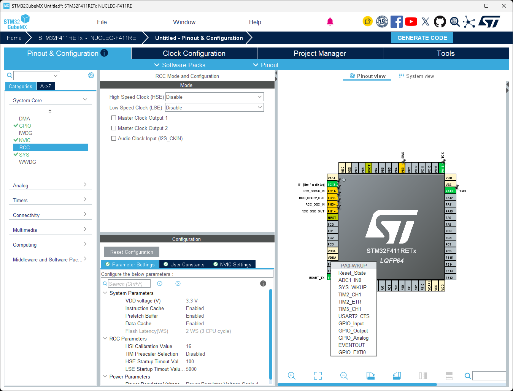
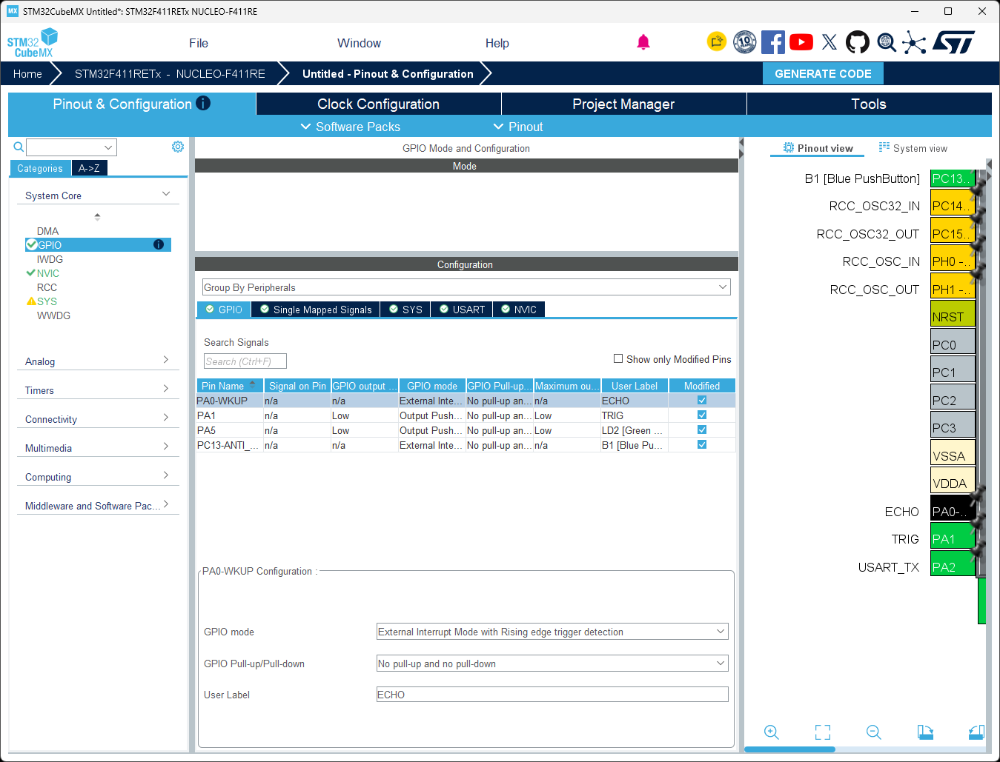
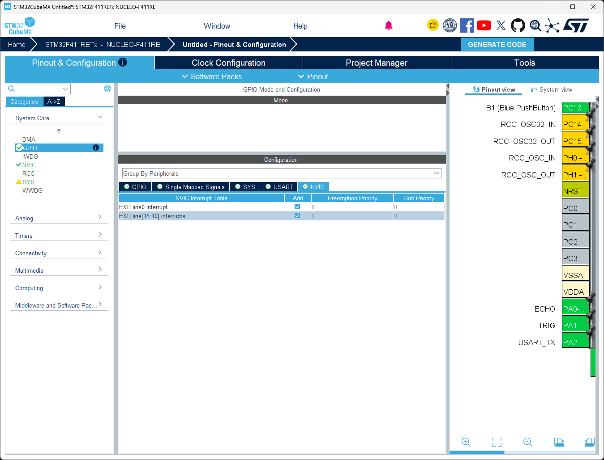
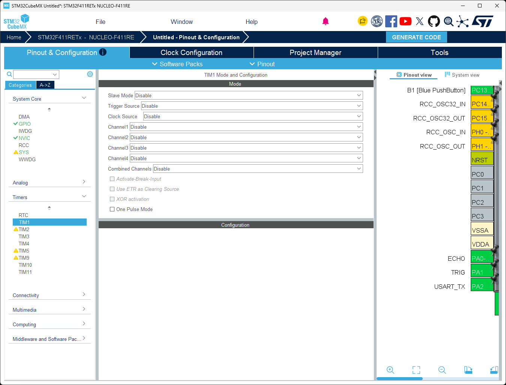
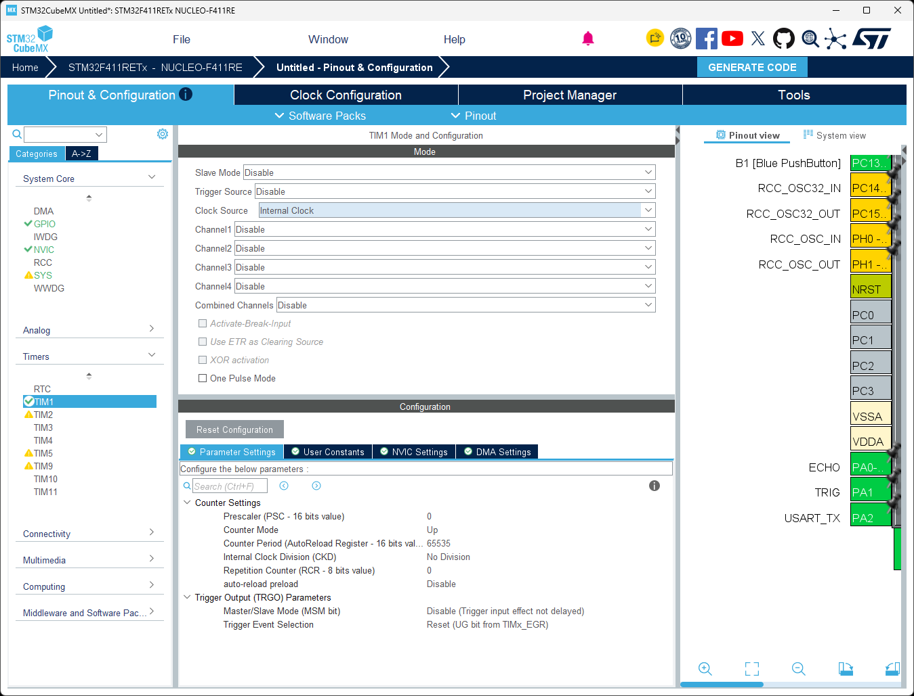
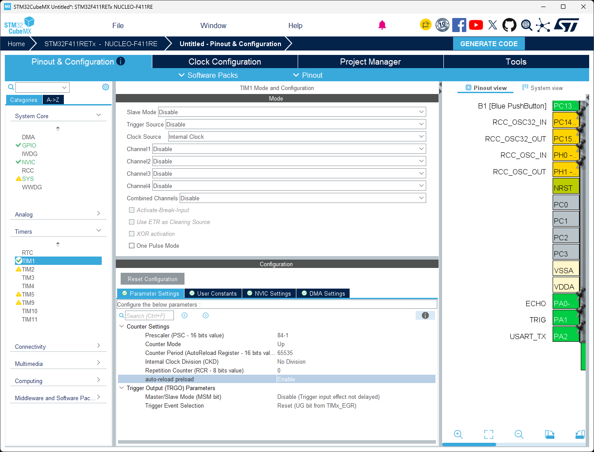

# STEP02 - 초음파 거리 측정

> 상태: **코드 구현/빌드 완료. 보드 동작 확인 완료.**
> 센서: HC-SR04 (5 V) 기준
> 측정: 5 Hz 샘플링, 1 Hz 중앙값 출력
> 빌드: 0 errors, 0 warnings

---

## 1. 목표

- HC-SR04로 거리를 측정한다.
- "몇 초마다 정확한 데이터를 확인한다"를 **측정 가능한 숫자**로 바꾼다.
- `HAL_Delay()` 없이 **비차단 상태 머신**으로 측정한다.
- 타임스탬프, 오류 횟수, 필터 결과를 UART CSV로 확인한다.
- LED 점멸은 계속 동작하게 두어 **여러 작업이 서로를 막지 않는지** 확인한다.

이번 단계에서 확정한 값:

| 항목 | 값 |
|---|---|
| 센서 | HC-SR04 |
| TRIG | PA1 (GPIO 출력) |
| ECHO | PA0 (EXTI 양쪽 에지) |
| 샘플 주기 | 200 ms (5 Hz) |
| 출력 주기 | 1000 ms (1 Hz) |
| 필터 | 최근 5개 중앙값 |
| 측정 타임아웃 | 35 ms |
| 유효 펄스 | 100 ~ 30000 us |
| 유효 거리 | 20 ~ 4000 mm |
| 음속 | 343 m/s (20 °C 기준) |
| 목표 정확도 | ±1 cm (0.2 ~ 2 m, 평평한 물체) |

---

## 2. 준비물

- NUCLEO-F411RE
- HC-SR04 초음파 센서
- 저항 1 kΩ, 2 kΩ 각 1개
- 점퍼선, 브레드보드
- USB 케이블 (ST-LINK, 데이터 지원)
- 시리얼 프로그램 (Tera Term / PuTTY / VS Code)
- 자 또는 줄자

---

## 3. 배선

### 3.1 HC-SR04 핀

| HC-SR04 | 연결 |
|---|---|
| VCC | NUCLEO **5 V** |
| GND | NUCLEO GND |
| TRIG | PA1 |
| ECHO | 분압 후 PA0 |

### 3.2 ECHO 전압 분압

HC-SR04의 ECHO는 **5 V 출력**이다. STM32 GPIO에 직접 연결하지 않는다.

```text
HC-SR04 ECHO ---- 1 kΩ ----+---- PA0
                           |
                          2 kΩ
                           |
                          GND
```

- PA0 전압: `5 V × 2 kΩ / (1 kΩ + 2 kΩ) ≈ 3.33 V`
- GND는 센서와 보드가 **반드시 공통**이어야 한다.
- HC-SR04는 3.3 V에서도 동작하는 것처럼 보일 수 있지만, 거리 정확도와 안정성이 떨어진다. **5 V 전원**을 사용한다.

### 3.3 연결 확인

- 전원을 넣기 전에 5 V와 GND가 바뀌지 않았는지 확인한다.
- PA0에는 분압 노드만 연결한다. ECHO를 직접 PA0에 꽂지 않는다.
- PA1은 TRIG 출력이다.
- PA0/PA1은 NUCLEO의 Arduino 아날로그 헤더 A0/A1 위치다.

---

 <br>
 <br>
 <br>
 <br>
 <br>
 <br>
 <br>
 <br>
 <br>
 <br>
 <br>
 <br>
 <br>
 <br>
 <br>
 <br>


### ultrasonic.h

```
#ifndef ULTRASONIC_H
#define ULTRASONIC_H

#ifdef __cplusplus
extern "C" {
#endif

#include <stdint.h>
#include "stm32f4xx_hal.h"

typedef struct
{
  uint32_t timestamp_ms;
  uint32_t errors;
  uint16_t distance_ref_mm;
  uint16_t distance_mm;
  uint8_t valid;
} Ultrasonic_Result;

extern volatile uint16_t g_trace_echo_ticks;
extern volatile uint8_t g_trace_echo_edge;
extern volatile uint8_t g_trace_echo_state;
extern volatile uint32_t g_trace_edge_count;

void Ultrasonic_Init(void);
void Ultrasonic_Task(void);
uint8_t Ultrasonic_GetResult(Ultrasonic_Result *result);
uint16_t Ultrasonic_GetLastEchoTicks(void);
uint8_t Ultrasonic_IsIdle(void);
void Ultrasonic_SetSoundSpeedX10(uint16_t speed_x10);
void Ultrasonic_OnEchoEdge(void);

#ifdef __cplusplus
}
#endif

#endif

```


### ultrasonic.c

```
#include "ultrasonic.h"
#include "main.h"

extern TIM_HandleTypeDef htim1;

volatile uint16_t g_trace_echo_ticks;
volatile uint8_t g_trace_echo_edge;
volatile uint8_t g_trace_echo_state;
volatile uint32_t g_trace_edge_count;

#define US_SAMPLE_PERIOD_MS 200U
#define US_PUBLISH_PERIOD_MS 1000U
#define US_ECHO_TIMEOUT_MS 35U
#define US_TRIG_PULSE_US 10U
#define US_TIMER_TICKS_PER_US 1U
#define US_MIN_ECHO_TICKS (100U * US_TIMER_TICKS_PER_US)
#define US_MAX_ECHO_TICKS (30000U * US_TIMER_TICKS_PER_US)
#define US_MIN_DISTANCE_MM 20U
#define US_MAX_DISTANCE_MM 4000U
#define US_FILTER_SIZE 5U
#define US_REFERENCE_SOUND_SPEED_X10 3430U
#define US_DEFAULT_SOUND_SPEED_X10 US_REFERENCE_SOUND_SPEED_X10
#define US_MIN_SOUND_SPEED_X10 2500U
#define US_MAX_SOUND_SPEED_X10 4000U

typedef enum
{
  US_STATE_IDLE = 0,
  US_STATE_WAIT_ECHO
} Ultrasonic_State;

static TIM_HandleTypeDef *s_htim;
static volatile Ultrasonic_State s_state;
static uint32_t s_lastSampleTick;
static uint32_t s_lastPublishTick;
static uint32_t s_echoStartTick;
static uint16_t s_echoStartCnt;
static volatile uint16_t s_echoWidthTicks;
static volatile uint8_t s_echoRising;
static volatile uint8_t s_echoDone;
static uint16_t s_samplesRef[US_FILTER_SIZE];
static uint16_t s_samplesCorr[US_FILTER_SIZE];
static uint8_t s_sampleCount;
static uint8_t s_sampleIndex;
static uint32_t s_errorCount;
static uint16_t s_soundSpeedX10;
static Ultrasonic_Result s_result;
static volatile uint8_t s_resultReady;

static uint16_t US_GetCounter(void);
static void US_StoreSample(uint32_t width_ticks);
static uint16_t US_Median(const uint16_t *samples);
static void US_Publish(uint32_t now);

static uint16_t US_GetCounter(void)
{
  return (uint16_t)__HAL_TIM_GET_COUNTER(s_htim);
}

void Ultrasonic_Init(void)
{
  s_htim = &htim1;
  HAL_GPIO_WritePin(TRIG_GPIO_Port, TRIG_Pin, GPIO_PIN_RESET);

  if (HAL_TIM_Base_Start(s_htim) != HAL_OK)
  {
    Error_Handler();
  }

  s_state = US_STATE_IDLE;
  s_lastSampleTick = HAL_GetTick();
  s_lastPublishTick = s_lastSampleTick;
  s_echoStartTick = 0U;
  s_echoStartCnt = 0U;
  s_echoWidthTicks = 0U;
  s_echoRising = 0U;
  s_echoDone = 0U;
  s_sampleCount = 0U;
  s_sampleIndex = 0U;
  s_errorCount = 0U;
  s_soundSpeedX10 = US_DEFAULT_SOUND_SPEED_X10;
  s_resultReady = 0U;
  s_result.timestamp_ms = 0U;
  s_result.distance_ref_mm = 0U;
  s_result.distance_mm = 0U;
  s_result.valid = 0U;
  s_result.errors = 0U;
  g_trace_echo_ticks = 0U;
  g_trace_echo_edge = 0U;
  g_trace_echo_state = 0U;
  g_trace_edge_count = 0U;
}

void Ultrasonic_Task(void)
{
  uint32_t now;
  uint16_t trigStartCnt;

  if (s_htim == NULL)
  {
    return;
  }

  now = HAL_GetTick();

  switch (s_state)
  {
    case US_STATE_IDLE:
      if ((now - s_lastSampleTick) >= US_SAMPLE_PERIOD_MS)
      {
        s_lastSampleTick = now;
        s_echoRising = 0U;
        s_echoDone = 0U;

        trigStartCnt = US_GetCounter();
        HAL_GPIO_WritePin(TRIG_GPIO_Port, TRIG_Pin, GPIO_PIN_SET);
        while ((uint16_t)(US_GetCounter() - trigStartCnt) < US_TRIG_PULSE_US)
        {
        }
        HAL_GPIO_WritePin(TRIG_GPIO_Port, TRIG_Pin, GPIO_PIN_RESET);

        s_echoStartTick = now;
        s_state = US_STATE_WAIT_ECHO;
        g_trace_echo_state = 2U;
      }
      break;

    case US_STATE_WAIT_ECHO:
      if (s_echoDone != 0U)
      {
        if (s_echoDone == 1U)
        {
          US_StoreSample(s_echoWidthTicks);
        }
        else
        {
          s_errorCount++;
        }
        s_echoDone = 0U;
        s_state = US_STATE_IDLE;
      }
      else if ((now - s_echoStartTick) >= US_ECHO_TIMEOUT_MS)
      {
        s_errorCount++;
        s_state = US_STATE_IDLE;
        g_trace_echo_edge = 0U;
        g_trace_echo_state = 0U;
      }
      break;

    default:
      s_state = US_STATE_IDLE;
      break;
  }

  if ((now - s_lastPublishTick) >= US_PUBLISH_PERIOD_MS)
  {
    s_lastPublishTick = now;
    US_Publish(now);
  }
}

uint8_t Ultrasonic_GetResult(Ultrasonic_Result *result)
{
  if ((result == NULL) || (s_resultReady == 0U))
  {
    return 0U;
  }

  *result = s_result;
  s_resultReady = 0U;
  return 1U;
}

uint8_t Ultrasonic_IsIdle(void)
{
  return (s_state == US_STATE_IDLE) ? 1U : 0U;
}

void Ultrasonic_SetSoundSpeedX10(uint16_t speed_x10)
{
  if ((speed_x10 >= US_MIN_SOUND_SPEED_X10) && (speed_x10 <= US_MAX_SOUND_SPEED_X10))
  {
    s_soundSpeedX10 = speed_x10;
  }
}

uint16_t Ultrasonic_GetLastEchoTicks(void)
{
  return s_echoWidthTicks;
}

void Ultrasonic_OnEchoEdge(void)
{
  uint16_t now;
  uint16_t width;

  if (s_htim == NULL)
  {
    return;
  }

  now = US_GetCounter();

  if (HAL_GPIO_ReadPin(ECHO_GPIO_Port, ECHO_Pin) == GPIO_PIN_SET)
  {
    if ((s_state == US_STATE_WAIT_ECHO) && (s_echoRising == 0U))
    {
      s_echoStartCnt = now;
      s_echoRising = 1U;
      g_trace_echo_edge = 1U;
      g_trace_echo_state = 1U;
      g_trace_edge_count++;
    }
  }
  else if (s_echoRising != 0U)
  {
    width = (uint16_t)(now - s_echoStartCnt);
    s_echoRising = 0U;
    s_echoWidthTicks = width;
    g_trace_echo_ticks = width;
    g_trace_echo_edge = 0U;
    g_trace_echo_state = 0U;
    g_trace_edge_count++;

    if ((width >= US_MIN_ECHO_TICKS) && (width <= US_MAX_ECHO_TICKS))
    {
      s_echoDone = 1U;
    }
    else
    {
      s_echoDone = 2U;
    }
  }
}

static void US_StoreSample(uint32_t width_ticks)
{
  uint32_t width_us = width_ticks / US_TIMER_TICKS_PER_US;
  uint32_t distance_ref_mm = (width_us * US_REFERENCE_SOUND_SPEED_X10) / 20000U;
  uint32_t distance_mm = (width_us * s_soundSpeedX10) / 20000U;

  if ((distance_mm >= US_MIN_DISTANCE_MM) && (distance_mm <= US_MAX_DISTANCE_MM))
  {
    s_samplesRef[s_sampleIndex] = (uint16_t)distance_ref_mm;
    s_samplesCorr[s_sampleIndex] = (uint16_t)distance_mm;
    s_sampleIndex = (uint8_t)((s_sampleIndex + 1U) % US_FILTER_SIZE);
    if (s_sampleCount < US_FILTER_SIZE)
    {
      s_sampleCount++;
    }
  }
  else
  {
    s_errorCount++;
  }
}

static uint16_t US_Median(const uint16_t *samples)
{
  uint16_t sorted[US_FILTER_SIZE];
  uint8_t i;
  uint8_t j;

  for (i = 0U; i < s_sampleCount; i++)
  {
    sorted[i] = samples[i];
  }

  for (i = 0U; (uint8_t)(i + 1U) < s_sampleCount; i++)
  {
    for (j = (uint8_t)(i + 1U); j < s_sampleCount; j++)
    {
      if (sorted[j] < sorted[i])
      {
        uint16_t temp = sorted[i];
        sorted[i] = sorted[j];
        sorted[j] = temp;
      }
    }
  }

  return sorted[s_sampleCount / 2U];
}

static void US_Publish(uint32_t now)
{
  s_result.timestamp_ms = now;

  if (s_sampleCount > 0U)
  {
    s_result.distance_ref_mm = US_Median(s_samplesRef);
    s_result.distance_mm = US_Median(s_samplesCorr);
    s_result.valid = 1U;
  }
  else
  {
    s_result.distance_ref_mm = 0U;
    s_result.distance_mm = 0U;
    s_result.valid = 0U;
  }

  s_result.errors = s_errorCount;
  s_resultReady = 1U;

  s_sampleCount = 0U;
  s_sampleIndex = 0U;
}

```

### main.c

```
/* USER CODE BEGIN Includes */
#include <stdio.h>
#include "ultrasonic.h"
/* USER CODE END Includes */
```

```
/* USER CODE BEGIN 0 */
#ifdef __GNUC__
#define PUTCHAR_PROTOTYPE int __io_putchar(int ch)
#else
#define PUTCHAR_PROTOTYPE int fputc(int ch, FILE *f)
#endif

PUTCHAR_PROTOTYPE
{
  if (ch == '\n')
  {
    HAL_UART_Transmit(&huart2, (uint8_t *)"\r", 1, 0xFFFF);
  }
  HAL_UART_Transmit(&huart2, (uint8_t *)&ch, 1, 0xFFFF);

  return ch;
}

static void Sensor_Task(void)
{
  Ultrasonic_Result result;
  char line[80];

  Ultrasonic_Task();

  if (Ultrasonic_GetResult(&result) != 0U)
  {
    (void)snprintf(line, sizeof(line), "D,%lu,%u,%u,%lu\n",
                   (unsigned long)result.timestamp_ms,
                   (unsigned int)result.distance_mm,
                   (unsigned int)result.valid,
                   (unsigned long)result.errors);
    printf("%s", line);
    printf("C,%u\n", (unsigned int)Ultrasonic_GetLastEchoTicks());
  }
}
/* USER CODE END 0 */
```


```
  /* USER CODE BEGIN 2 */
  Ultrasonic_Init();
  printf("\n=== F411_TASK_LAB Step 2: Ultrasonic ===\n");
  printf("HC-SR04: TRIG=PA1, ECHO=PA0, 5 Hz sample, 1 Hz median\n");
  printf("TIM1: PCLK2=%luHz divider=%lu ARR=%lu tick=%luHz\n",
         (unsigned long)HAL_RCC_GetPCLK2Freq(),
         (unsigned long)(htim1.Init.Prescaler + 1U),
         (unsigned long)htim1.Init.Period,
         (unsigned long)(HAL_RCC_GetPCLK2Freq() / (htim1.Init.Prescaler + 1U)));
  /* USER CODE END 2 */
```

```
  /* Infinite loop */
  /* USER CODE BEGIN WHILE */
  while (1)
  {
    /* USER CODE END WHILE */

    /* USER CODE BEGIN 3 */
    Sensor_Task();
  }
  /* USER CODE END 3 */
```

```
/* USER CODE BEGIN 4 */
void HAL_GPIO_EXTI_Callback(uint16_t GPIO_Pin)
{
  if (GPIO_Pin == ECHO_Pin)
  {
    Ultrasonic_OnEchoEdge();
  }
  else if (GPIO_Pin == B1_Pin)
  {
    HAL_GPIO_TogglePin(LD2_GPIO_Port, LD2_Pin);
  }
}
/* USER CODE END 4 */
```

### stm32f4xx_it.c

```
/**
  * @brief This function handles EXTI line0 interrupt.
  */
void EXTI0_IRQHandler(void)
{
  /* USER CODE BEGIN EXTI0_IRQn 0 */

  /* USER CODE END EXTI0_IRQn 0 */
  HAL_GPIO_EXTI_IRQHandler(ECHO_Pin);
  /* USER CODE BEGIN EXTI0_IRQn 1 */

  /* USER CODE END EXTI0_IRQn 1 */
}

/* USER CODE BEGIN 1 */
void EXTI15_10_IRQHandler(void)
{
  g_trace_b1_irq ^= 1U;
  g_trace_b1_irq_count++;
  HAL_GPIO_EXTI_IRQHandler(B1_Pin);
}
/* USER CODE END 1 */
```


