# GPIO
   - [Datasheet - STM32F411xC STM32F411xE](https://www.st.com/resource/en/datasheet/stm32f411ce.pdf)
   - [RM0383 Reference Manual](https://www.st.com/resource/en/reference_manual/rm0383-stm32f411xce-advanced-armbased-32bit-mcus-stmicroelectronics.pdf)

## Table of Contents
- [1. Architecture](#1-architecture)
- [2. MemoryMap](#2-memorymap)
- [3. Register](#3-register)
- [4. Test](#4-test)

## 1.Architecture

F103

   
  

* 각 GPIO 핀은 소프트웨어로 출력(푸시풀 또는 오픈 드레인), 입력(풀업 또는 풀다운 여부 선택), 또는 주변 장치의 대체 기능으로 구성할 수 있습니다. 
* 대부분의 GPIO 핀은 디지털 또는 아날로그 대체 기능과 공유됩니다. 모든 GPIO는 고전류를 지원합니다. 
* I/O의 대체 기능 구성은 필요 시 특정 순서를 따라 잠글 수 있으며, 이는 I/O 레지스터에 불필요한 기록이 이루어지는 것을 방지하기 위함입니다. 
* I/O는 APB2 버스에 연결되어 있으며, 최대 18 MHz의 토글 속도를 지원합니다. 

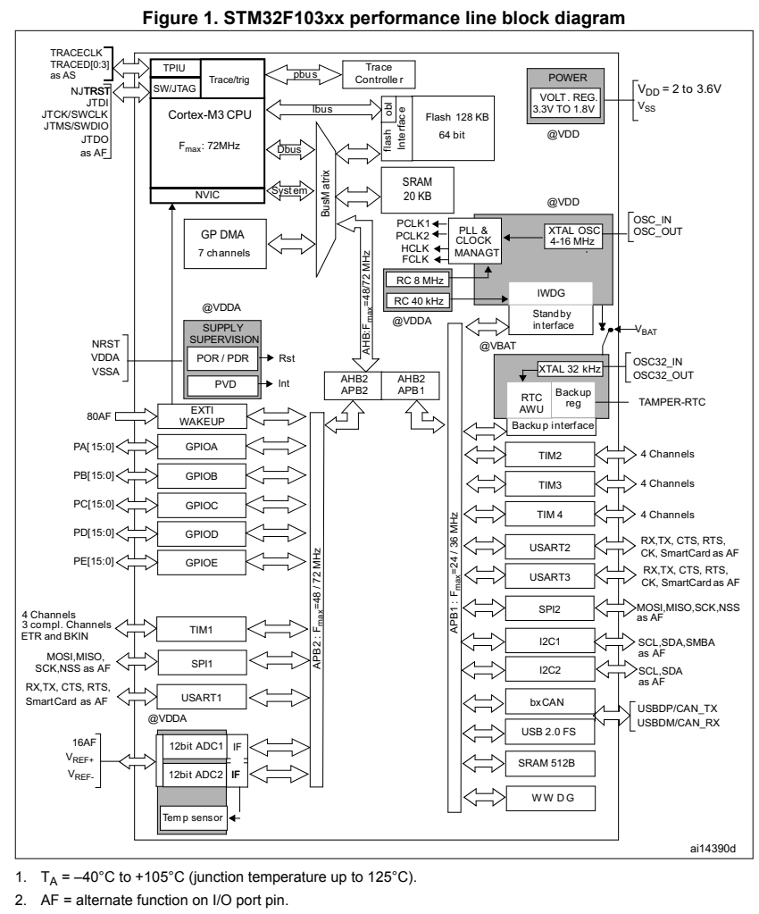  

   

F411

   
#### 메모리 및 버스 아키텍처

##### 시스템 아키텍처

* STM32F411xC/E의 메인 시스템은 32비트 다중 계층(multilayer) AHB 버스 매트릭스로 구성되어 있으며, 이를 통해 다음 요소들이 상호 연결됩니다.  
* 6개의 마스터(Master):
   * FPU를 포함한 Cortex-M4 코어의 I-버스(I-bus), D-버스(D-bus) 및 S-버스(S-bus)
   * DMA1 메모리 버스
   * DMA2 메모리 버스
   * DMA2 주변장치(peripheral) 버스
* 5개의 슬레이브(Slave):
   * 내부 플래시 메모리 ICode 버스
   * 내부 플래시 메모리 DCode 버스
   * 메인 내부 SRAM
   * AHB-APB 브리지 및 APB 주변장치를 포함한 AHB1 주변장치
   * AHB2 주변장치

버스 매트릭스는 마스터가 슬레이브에 접근할 수 있도록 경로를 제공하며, 여러 고속 주변장치가 동시에 작동할 때에도 동시 접근을 가능하게 하여 효율적인 동작을 지원합니다. 이러한 아키텍처는 그림 1에 나타나 있습니다.

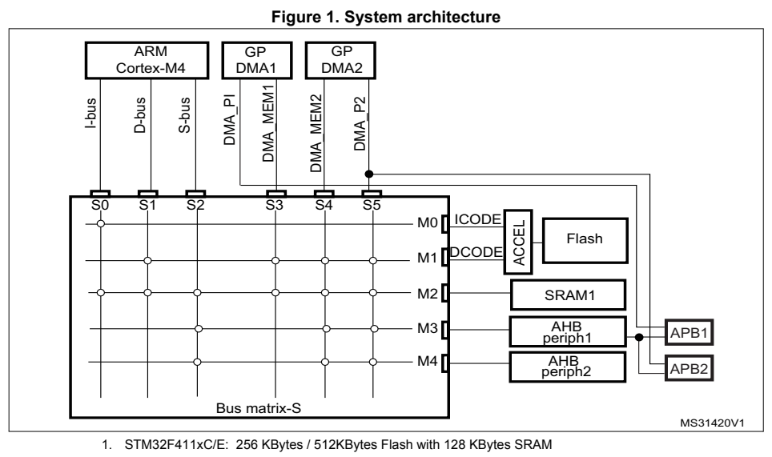  

#### 2.1.1 I-bus(명령 버스)
이 버스는 FPU가 포함된 Cortex®-M4 코어의 명령 버스(Instruction bus)를 BusMatrix에 연결합니다. 코어는 이 버스를 사용하여 명령을 가져옵니다(fetch). 이 버스의 대상은 코드가 저장된 메모리(내부 플래시 메모리/SRAM)입니다.

#### 2.1.2 D-bus(데이터 버스)
이 버스는 FPU가 포함된 Cortex®-M4의 데이터 버스를 BusMatrix에 연결합니다. 코어는 이 버스를 사용하여 리터럴(상수) 값을 로드하거나 디버깅을 위한 접근을 수행합니다. 이 버스의 대상은 코드나 데이터가 저장된 메모리(내부 플래시 메모리/SRAM)입니다.

#### 2.1.3 S-bus(시스템 버스)
이 버스는 FPU가 포함된 Cortex®-M4 코어의 시스템 버스를 BusMatrix에 연결합니다. 이 버스는 주변 장치(peripheral)나 SRAM에 위치한 데이터에 접근하는 데 사용됩니다. 명령을 가져오는(fetch) 용도로도 사용할 수 있지만, ICode 버스를 사용하는 것보다 효율성은 떨어집니다. 이 버스의 대상은 내부 SRAM1, AHB1 주변 장치(APB 주변 장치 포함), 그리고 AHB2 주변 장치입니다.

#### 2.1.4 DMA 메모리 버스
이 버스는 DMA 메모리 버스 마스터 인터페이스를 BusMatrix에 연결합니다. DMA가 메모리와 데이터를 주고받는(전송하는) 작업을 수행할 때 사용됩니다. 이 버스의 대상은 데이터 메모리(내부 플래시 메모리, 내부 SRAM)이며, S4의 경우 AHB1/AHB2 주변 장치(APB 주변 장치 포함)도 대상에 포함됩니다.

#### 2.1.5 DMA 주변 장치 버스
이 버스는 DMA 주변 장치 마스터 버스 인터페이스를 BusMatrix에 연결합니다. DMA가 AHB 주변 장치에 접근하거나 메모리 간(memory-to-memory) 데이터 전송을 수행할 때 사용됩니다. 이 버스의 대상은 AHB 및 APB 주변 장치와 데이터 메모리(플래시 메모리 및 내부 SRAM)입니다.

#### 2.1.6 BusMatrix(버스 매트릭스)
BusMatrix는 마스터 간의 접근 중재(arbitration)를 관리합니다. 중재 방식으로는 라운드 로빈(round-robin) 알고리즘이 사용됩니다. 

#### 2.1.7 AHB/APB 브리지(APB)
두 개의 AHB/APB 브리지인 APB1과 APB2는 AHB 버스와 두 개의 APB 버스 간에 완전 동기식 연결을 제공하며, 이를 통해 주변 장치(peripheral)의 동작 주파수를 유연하게 선택할 수 있습니다.
APB1 및 APB2의 최대 동작 주파수에 대한 자세한 내용은 해당 디바이스의 데이터시트를 참조하고, AHB 및 APB 주변 장치의 주소 매핑에 대해서는 표 1을 참조하십시오.
디바이스가 리셋될 때마다 모든 주변 장치 클록은 비활성화됩니다(SRAM 및 플래시 메모리 인터페이스는 예외). 주변 장치를 사용하려면 먼저 RCC_AHBxENR 또는 RCC_APBxENR 레지스터를 통해 해당 주변 장치의 클록을 활성화해야 합니다.

참고: APB 레지스터에 대해 16비트 또는 8비트 액세스를 수행하면, 해당 액세스는 32비트 액세스로 변환됩니다. 즉, 브리지가 16비트 또는 8비트 데이터를 복제하여 32비트 벡터를 구성합니다.
   
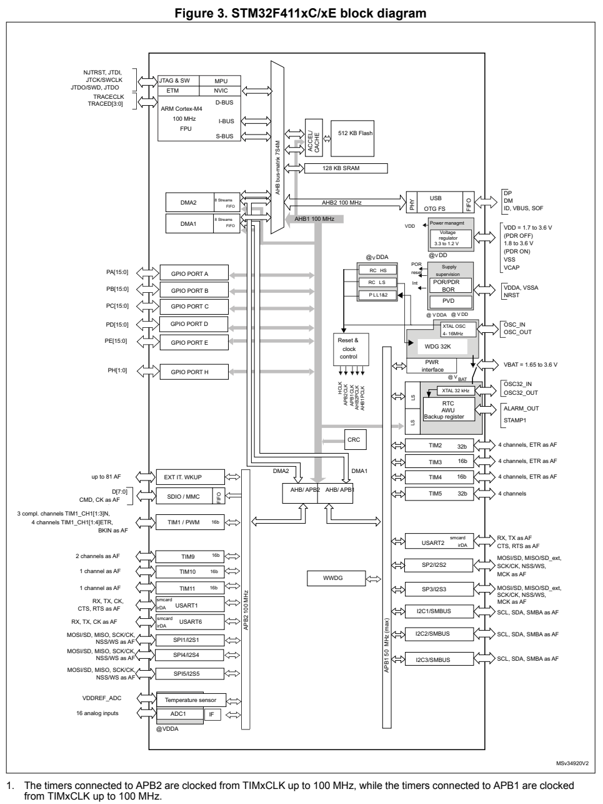  

## 2. CLOCK

F103

  
   
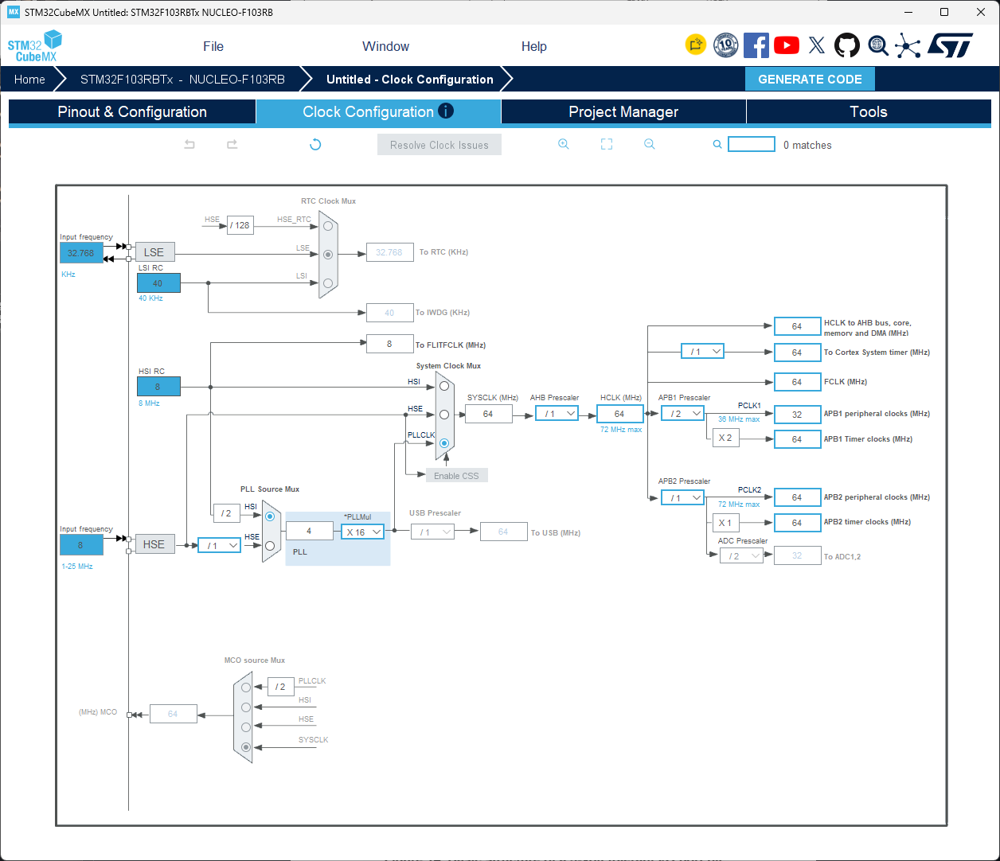  
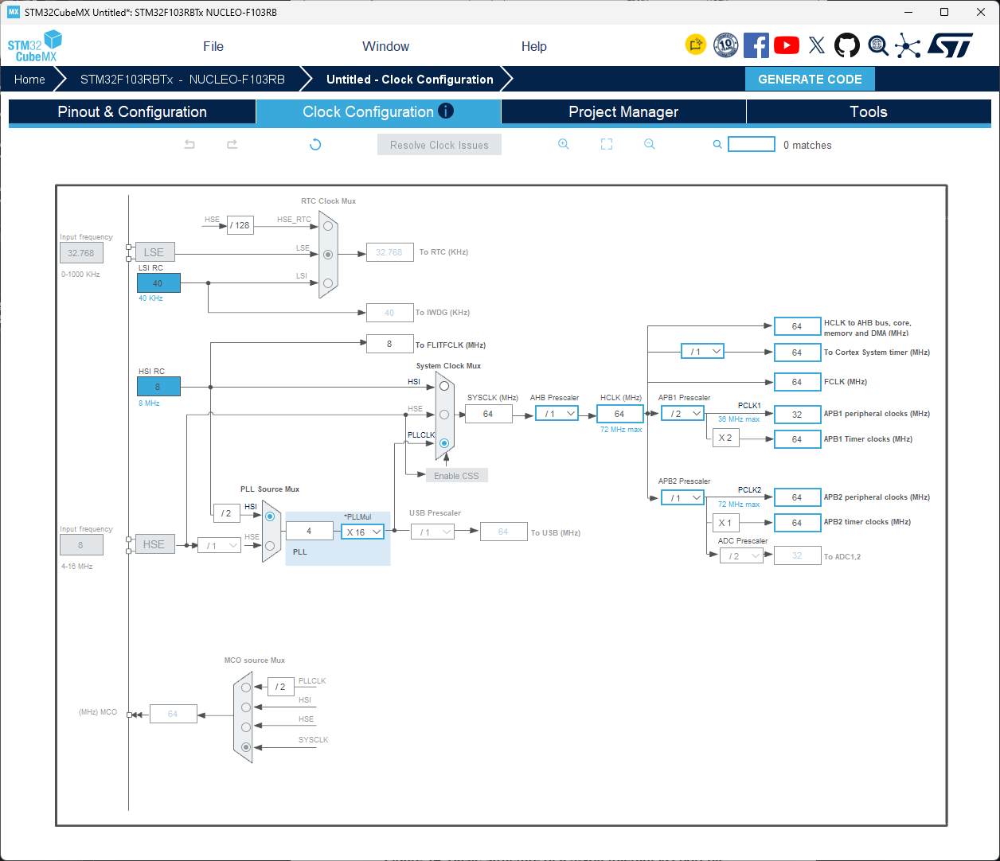  

F411

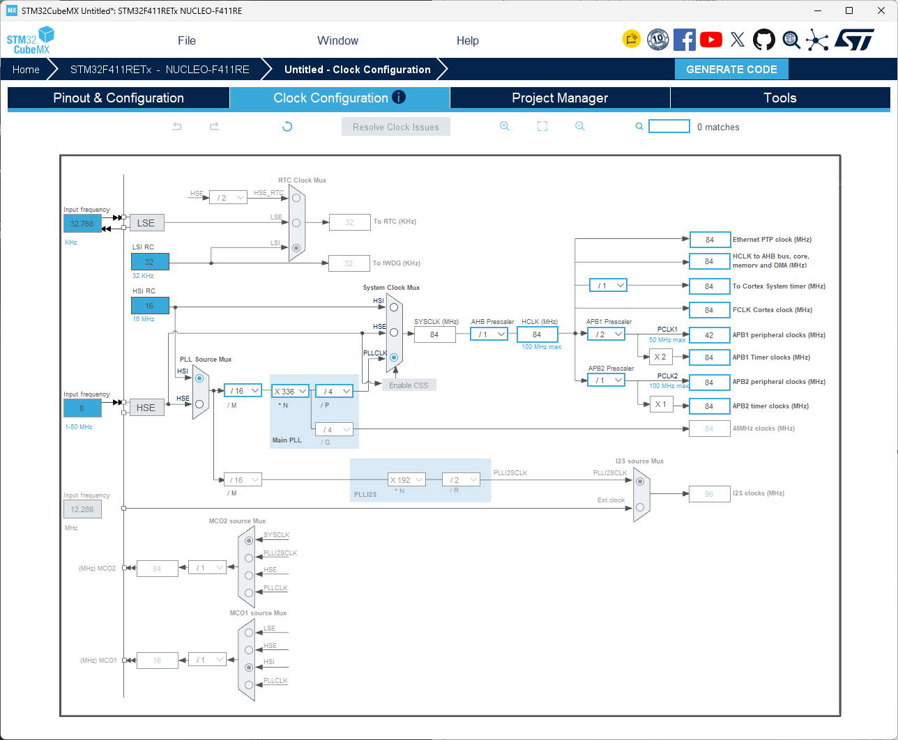  
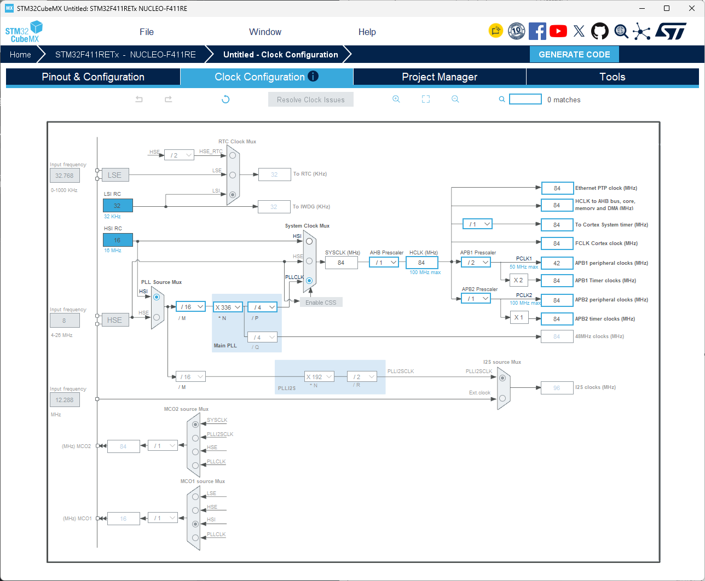  

## 3.MemoryMap

F103

  
   
  
  
  
  
  
  
  
  
  
  
  

F411

### 4.2 메모리 구성

프로그램 메모리, 데이터 메모리, 레지스터 및 I/O 포트는 동일한 4GB 선형 주소 공간 내에 구성됩니다.
메모리 내의 바이트는 리틀 엔디언(little endian) 형식으로 저장됩니다. 워드(word)에서 가장 낮은 주소의 바이트는 최하위 바이트(LSB, least significant byte)로 간주되며, 가장 높은 주소의 바이트는 최상위 바이트(MSB, most significant byte)로 간주됩니다.
주변 장치(peripheral) 레지스터의 상세 매핑에 대해서는 관련 장(chapter)을 참조하십시오. 주소 지정이 가능한 메모리 공간은 각각 512MB 크기의 8개 주요 블록으로 나뉩니다.
온칩(on-chip) 메모리나 주변 장치에 할당되지 않은 모든 메모리 영역은 '예약됨(Reserved)'으로 간주됩니다. 제품 데이터시트에 있는 메모리 맵 그림을 참조하십시오.

### 4.3 메모리 맵

메모리 맵에 대한 전체적인 구성도는 사용 중인 장치의 데이터시트를 참조하십시오. 표 1은 STM32F411xC/E 장치에서 사용할 수 있는 주변 장치들의 경계 주소를 나타냅니다.

#### 2.3.1 내장 SRAM

STM32F411xC/E 디바이스는 128 K바이트의 시스템 SRAM을 갖추고 있습니다.
내장 SRAM은 바이트, 하프 워드(16비트) 또는 풀 워드(32비트) 단위로 액세스할 수 있습니다. 읽기 및 쓰기 작업은 CPU 속도로 수행되며, 대기 상태(wait state)는 0입니다.
SRAM에서 부팅하도록 설정되었거나 물리적 리맵(physical remap)이 선택된 경우, CPU는 시스템 버스 또는 I-Code/D-Code 버스를 통해 내장 SRAM에 액세스할 수 있습니다.
(SYSCFG 컨트롤러 내의 7.2.1절: SYSCFG 메모리 리맵 레지스터(SYSCFG_MEMRMP) 참조). SRAM에서 코드를 실행할 때 최대 성능을 얻으려면 물리적 리맵을 선택해야 합니다(부팅 시 또는 소프트웨어를 통해 설정 가능).

#### 2.3.2  플래시 메모리 개요
플래시 메모리 인터페이스는 CPU의 AHB I-Code 및 D-Code를 통한 플래시 메모리 액세스를 관리합니다. 이 인터페이스는 플래시 메모리의 삭제 및 프로그래밍 작업, 그리고 읽기/쓰기 보호 메커니즘을 구현합니다. 또한 명령어 프리페치(prefetch) 및 캐시 라인 시스템을 통해 코드 실행 속도를 높입니다.
플래시 메모리는 다음과 같이 구성됩니다:
• 섹터로 나뉜 메인 메모리 블록.
• 시스템 메모리 부팅 모드에서 디바이스가 부팅되는 시스템 메모리 영역.
• 사용자 데이터를 위한 512바이트의 OTP(일회성 프로그래밍 가능) 메모리.
• 읽기/쓰기 보호, BOR(Brown-Out Reset) 레벨, 워치독(소프트웨어/하드웨어), 그리고 Standby 또는 Stop 모드에서의 리셋 동작 등을 설정하기 위한 옵션 바이트(Option bytes).
자세한 내용은 3절: 내장 플래시 메모리 인터페이스를 참조하십시오.

#### 2.3.3 비트 밴딩(Bit banding)
FPU가 포함된 Cortex®-M4의 메모리 맵에는 두 개의 비트 밴드 영역이 있습니다. 이 영역들은 '앨리어스(alias) 영역'의 각 워드를 '비트 밴드 영역'의 특정 비트에 매핑합니다. 앨리어스 영역의 워드에 데이터를 쓰는 것은 비트 밴드 영역 내의 대상 비트에 대해 '읽기-수정-쓰기(read-modify-write)' 작업을 수행하는 것과 동일한 효과를 냅니다. STM32F4xx 디바이스에서는 주변 장치 레지스터와 SRAM 모두가 비트 밴드(bit-band) 영역에 매핑되어, 단일 비트 단위의 읽기 및 쓰기 작업이 가능합니다. 이러한 작업은 FPU를 사용하는 Cortex-M4를 통해서만 수행할 수 있으며, 다른 버스 마스터(예: DMA)를 통해서는 수행할 수 없습니다.
매핑 공식을 사용하면 에일리어스(alias) 영역의 각 워드를 비트 밴드 영역의 특정 비트에 대응시킬 수 있습니다. 매핑 공식은 다음과 같습니다.
bit_word_addr = bit_band_base + (byte_offset x 32) + (bit_number × 4)
여기서 각 항목의 의미는 다음과 같습니다.
– bit_word_addr: 대상 비트에 매핑되는 에일리어스 메모리 영역 내 워드의 주소
– bit_band_base: 에일리어스 영역의 시작 주소
– byte_offset: 대상 비트를 포함하고 있는 비트 밴드 영역 내 바이트의 번호(오프셋)
– bit_number: 대상 비트의 위치(0~7)

**예시**
다음 예시는 SRAM 주소 0x20000300에 위치한 바이트의 2번 비트를 별칭 영역(alias region)에 매핑하는 방법을 보여줍니다.
0x22006008 = 0x22000000 + (0x300*32) + (2*4)
주소 0x22006008에 데이터를 쓰는 것은 SRAM 주소 0x20000300에 있는 바이트의 2번 비트에 대해 '읽기-수정-쓰기(read-modify-write)' 작업을 수행하는 것과 동일한 효과를 냅니다.
주소 0x22006008을 읽으면 SRAM 주소 0x20000300에 있는 바이트의 2번 비트 값(0x01 또는 0x00)이 반환됩니다(0x01: 비트 설정됨, 0x00: 비트 해제됨).
비트 밴딩(bit-banding)에 대한 자세한 내용은 'Cortex-M4 with FPU 프로그래밍 매뉴얼'(1페이지의 '관련 문서' 참조)을 확인하십시오.

### 2.4 부팅 구성
고정된 메모리 맵에 따라 코드 영역은 주소 0x0000 0000부터 시작하며(ICode/DCode 버스를 통해 접근), 데이터 영역(SRAM)은 주소 0x2000 0000부터 시작합니다(시스템 버스를 통해 접근). Cortex-M4 with FPU CPU는 항상 ICode 버스를 통해 리셋 벡터를 가져오는데, 이는 부팅 공간이 코드 영역(일반적으로 플래시 메모리)에만 존재해야 함을 의미합니다. STM32F4xx 마이크로컨트롤러는 다른 메모리(내부 SRAM 등)에서도 부팅할 수 있도록 특별한 메커니즘을 구현하고 있습니다.
STM32F4xx에서는 표 2에 나타난 바와 같이 BOOT[1:0] 핀을 통해 세 가지 부팅 모드 중 하나를 선택할 수 있습니다. 

BOOT 핀의 값은 리셋 후 SYSCLK의 4번째 상승 에지(rising edge)에서 래치(latch)됩니다. 사용자는 리셋 후 BOOT1 및 BOOT0 핀을 설정하여 원하는 부팅 모드를 선택해야 합니다.
BOOT0는 전용 핀인 반면, BOOT1은 GPIO 핀과 공유됩니다. BOOT1 값이 샘플링되고 나면, 해당 GPIO 핀은 자유 상태가 되어 다른 용도로 사용할 수 있습니다.
장치가 대기(Standby) 모드에서 빠져나올 때도 BOOT 핀을 다시 샘플링합니다. 따라서 장치가 대기 모드에 있는 동안에도 원하는 부팅 모드 설정 상태를 유지해야 합니다. 이러한 시작 지연(startup delay)이 끝나면, CPU는 주소 0x0000 0000에서 스택 최상단(top-of-stack) 값을 가져온 다음, 0x0000 0004부터 시작되는 부팅 메모리 영역에서 코드 실행을 시작합니다.

참고: 장치가 SRAM에서 부팅되는 경우, 애플리케이션 초기화 코드 내에서 NVIC 예외 테이블과 오프셋 레지스터를 사용하여 SRAM 내의 벡터 테이블을 재배치(relocate)해야 합니다.

**내장 부트로더(Embedded bootloader)**
내장 부트로더 모드는 다음 직렬 인터페이스 중 하나를 사용하여 플래시 메모리를 재프로그래밍하는 데 사용됩니다.
• USART1 (PA9/PA10)
• USART2 (PD5/PD6)
• I2C1 (PB6/PB7)
• I2C2 (PB10/PB3)
• I2C3 (PA8/PB4)
• SPI1 (PA4/PA5/PA6/PA7)
• SPI2 (PB12/PB13/PB14/PB15)
• SPI3 (PA15/PC10/PC11/PC12)
• USB OTG FS (PA11/12) - 디바이스 모드(DFU: Device Firmware Upgrade)
USART 주변 장치는 내부 16 MHz 오실레이터(HSI) 주파수에서 작동하며, USB OTG FS는 1 MHz의 배수인 외부 클록(HSE, 4~26 MHz 범위)을 필요로 합니다. 내장 부트로더 코드는 시스템 메모리에 위치하며, 제조 과정에서 ST에 의해 프로그래밍됩니다. 자세한 내용은 애플리케이션 노트 AN2606을 참조하십시오.

**STM32F411xC/E에서의 물리적 리맵(Physical remap)**
부트 핀이 선택되면, 애플리케이션 소프트웨어는 코드 영역에서 접근 가능한 메모리를 수정할 수 있습니다(이를 통해 코드는 시스템 버스 대신 ICode 버스를 통해 실행될 수 있습니다). 이러한 수정은 SYSCFG 컨트롤러 내의 '7.2.1절: SYSCFG 메모리 리맵 레지스터(SYSCFG_MEMRMP)'를 프로그래밍함으로써 수행됩니다.
다음 메모리들을 리맵할 수 있습니다.
• 메인 플래시 메모리(Main Flash memory)
• 시스템 메모리(System memory)
• 내장 SRAM1(Embedded SRAM1)
임베디드 플래시 메모리 인터페이스

### 3.1 개요
플래시 메모리 인터페이스는 CPU의 AHB I-Code 및 D-Code를 통한 플래시 메모리 접근을 관리합니다. 이 인터페이스는 플래시 메모리의 삭제 및 프로그래밍 작업과 읽기/쓰기 보호 메커니즘을 구현합니다.
또한, 명령어 프리페치(prefetch) 및 캐시 라인 시스템을 통해 코드 실행 속도를 향상시킵니다.

### 3.2 주요 특징
• 플래시 메모리 읽기 작업
• 플래시 메모리 프로그래밍/삭제 작업
• 읽기/쓰기 보호 기능
• I-Code에 대한 프리페치(prefetch) 기능
• I-Code용 128비트 캐시 라인 64개
• D-Code용 128비트 캐시 라인 8개

그림 2는 시스템 아키텍처 내에서 플래시 메모리 인터페이스가 어떻게 연결되어 있는지 보여줍니다.

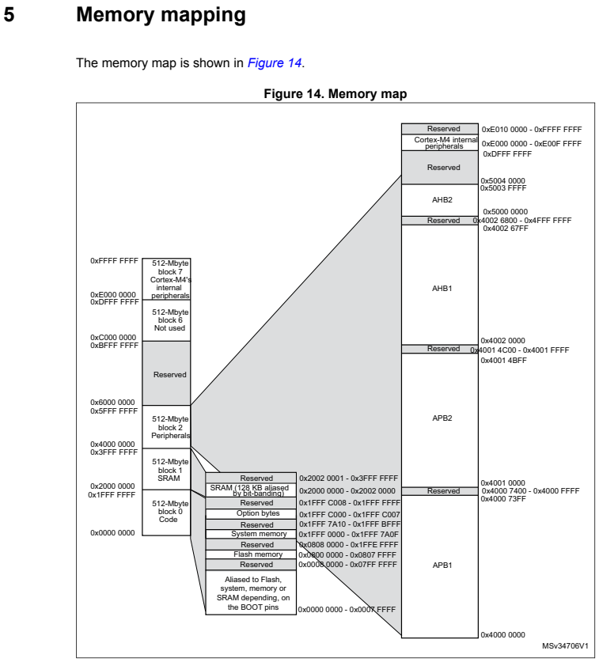  
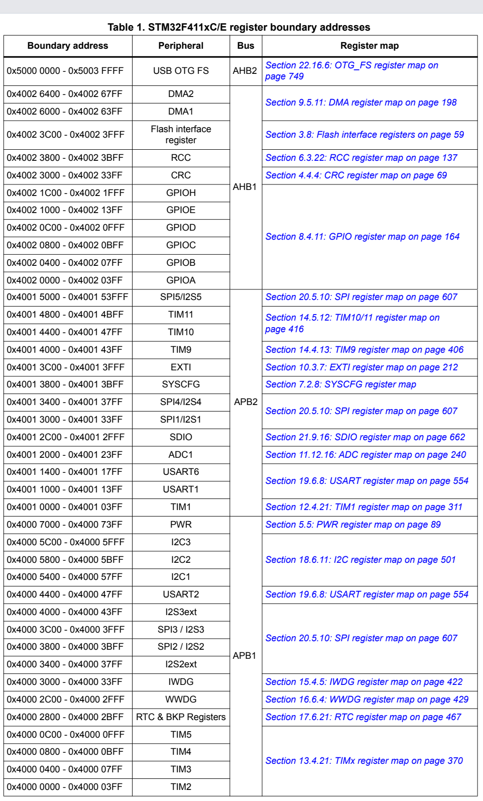  
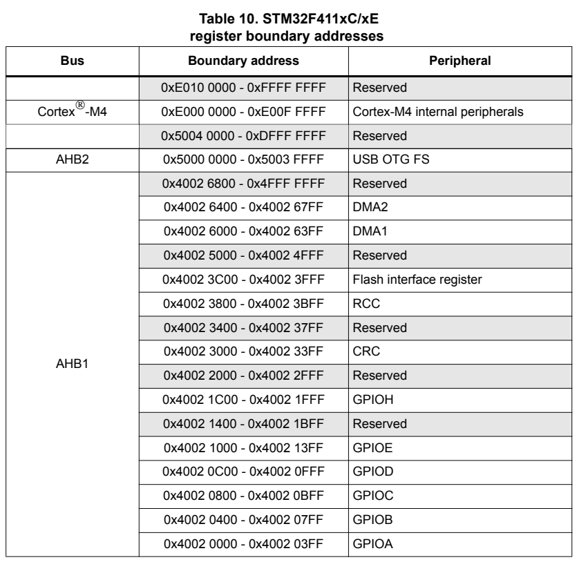  
  

## 4. GPIO

F103

   
## **2.3.21 GPIOs (general-purpose inputs/outputs)**

* Each of the GPIO pins can be configured by software as output (push-pull or open-drain), as input (with or without pull-up or pull-down) or as peripheral alternate function.
* Most of the GPIO pins are shared with digital or analog alternate functions. All GPIOs are high current- capable.
* The I/Os alternate function configuration can be locked if needed following a specific sequence in order to avoid spurious writing to the I/Os registers.
* I/Os on APB2 with up to 18 MHz toggling speed.

  

  
  

F411

   
## 8 범용 입출력(GPIO)
STM32F411xC/E 모델에서는 GPIO F/G/H/I/J/K를 사용할 수 없습니다(GPIOH0 및 GPIOH1은 제외).

### 8.1 GPIO 개요

각 범용 입출력(GPIO) 포트에는 4개의 32비트 설정 레지스터(GPIOx_MODER, GPIOx_OTYPER, GPIOx_OSPEEDR, GPIOx_PUPDR),  
2개의 32비트 데이터 레지스터(GPIOx_IDR, GPIOx_ODR),   
32비트 세트/리셋 레지스터(GPIOx_BSRR),   
32비트 잠금 레지스터(GPIOx_LCKR),   
그리고 2개의 32비트 대체 기능 선택 레지스터(GPIOx_AFRH, GPIOx_AFRL)가 포함되어 있습니다. 

### 8.2 GPIO 주요 특징

   * 최대 16개의 I/O 제어 가능
   * 출력 상태: 푸시-풀(push-pull) 또는 오픈-드레인(open-drain) + 풀업/풀다운(pull-up/down)
   * 출력 데이터 소스: 출력 데이터 레지스터(GPIOx_ODR) 또는 주변 장치(대체 기능 출력)
   * 각 I/O별 속도 설정 가능
   * 입력 상태: 플로팅(floating), 풀업/풀다운, 아날로그
   * 입력 데이터 목적지: 입력 데이터 레지스터(GPIOx_IDR) 또는 주변 장치(대체 기능 입력)
   * 비트 설정 및 리셋 레지스터(GPIOx_BSRR)를 통한 GPIOx_ODR의 비트 단위 쓰기 접근 지원
   * I/O 구성을 고정할 수 있는 잠금 메커니즘(GPIOx_LCKR) 제공
   * 아날로그 기능 지원
   * 대체 기능(Alternate Function, AF) 입출력 선택 레지스터 (I/O당 최대 16개의 AF 지원)
   * 2클럭 주기마다 상태를 변경할 수 있는 고속 토글(fast toggle) 기능
   * 유연한 핀 멀티플렉싱을 통해 I/O 핀을 범용 I/O(GPIO) 또는 다양한 주변 장치 기능으로 활용 가능

### 8.3 GPIO 기능 설명

데이터시트에 명시된 각 I/O 포트의 하드웨어 특성에 따라, 범용 I/O(GPIO) 포트의 각 비트는 소프트웨어를 통해 다음과 같은 여러 모드로 개별 설정할 수 있습니다.
   * 입력 플로팅(Input floating)
   * 입력 풀업(Input pull-up)
   * 입력 풀다운(Input pull-down)
   * 아날로그(Analog)
   * 오픈-드레인 출력 (풀업 또는 풀다운 기능 포함)
   * 푸시-풀 출력 (풀업 또는 풀다운 기능 포함)
   * 대체 기능 푸시-풀 출력 (풀업 또는 풀다운 기능 포함)
   * 대체 기능 오픈-드레인 출력 (풀업 또는 풀다운 기능 포함)

각 I/O 포트 비트는 자유롭게 프로그래밍할 수 있지만, I/O 포트 레지스터에 접근할 때는 32비트 워드, 하프 워드 또는 바이트 단위로 접근해야 합니다. GPIOx_BSRR 레지스터는 GPIO 레지스터에 대한 원자적(atomic) 읽기/수정 접근을 가능하게 합니다. 이를 통해 읽기 작업과 수정 작업 사이에 인터럽트(IRQ)가 발생할 위험을 방지할 수 있습니다. 5V 허용(5V-tolerant) I/O 포트 비트의 기본 구조를 보여줍니다. 표 26은 포트 비트의 가능한 구성들을 나타냅니다.

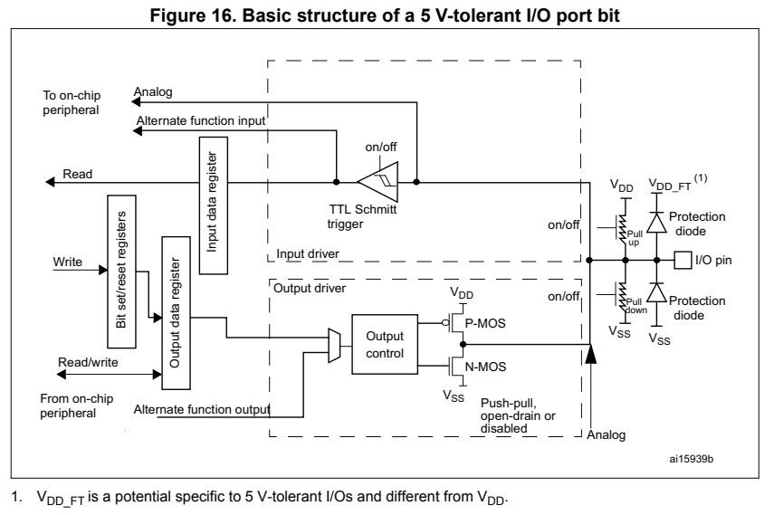  

#### 8.3.9 입력 구성

I/O 포트가 입력으로 설정된 경우:
   * 출력 버퍼가 비활성화됩니다.
   * 슈미트 트리거(Schmitt trigger) 입력이 활성화됩니다.
   * GPIOx_PUPDR 레지스터의 값에 따라 풀업(pull-up) 및 풀다운(pull-down) 저항이 활성화됩니다.
   * I/O 핀에 존재하는 데이터는 매 AHB 클록 주기마다 입력 데이터 레지스터로 샘플링됩니다.
   * 입력 데이터 레지스터를 읽으면 I/O 상태를 확인할 수 있습니다. 그림 18은 I/O 포트 비트의 입력 구성을 보여줍니다.

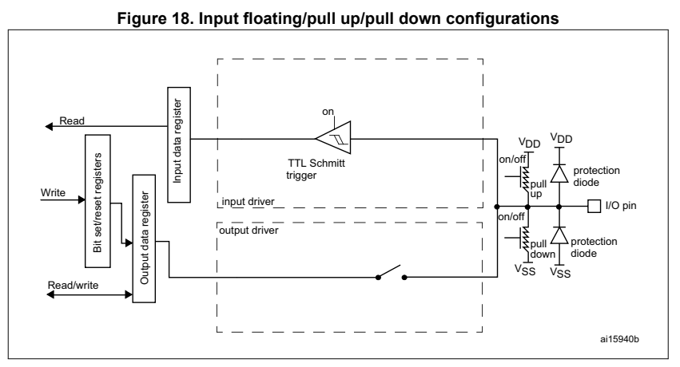  

#### 8.3.10 출력 구성
I/O 포트가 출력으로 설정된 경우:
   * 출력 버퍼가 활성화됩니다.

오픈 드레인(Open-drain) 모드: 출력 레지스터의 값이 '0'이면 N-MOS가 활성화되고, '1'이면 포트가 하이 임피던스(Hi-Z) 상태가 됩니다(P-MOS는 절대 활성화되지 않음). 푸시-풀(Push-pull) 모드: 출력 레지스터의 값이 '0'이면 N-MOS가 활성화되고, '1'이면 P-MOS가 활성화됩니다.

   * 슈미트 트리거(Schmitt trigger) 입력이 활성화됩니다.
   * 약한(weak) 풀업 및 풀다운 저항은 GPIOx_PUPDR 레지스터의 설정값에 따라 활성화 여부가 결정됩니다.
   * I/O 핀에 존재하는 데이터는 매 AHB 클록 주기마다 입력 데이터 레지스터로 샘플링됩니다.
   * 입력 데이터 레지스터를 읽으면 현재 I/O 상태를 확인할 수 있습니다.
   * 출력 데이터 레지스터를 읽으면 마지막으로 기록된 값을 확인할 수 있습니다. 그림 19는 I/O 포트 비트의 출력 구성을 보여줍니다.

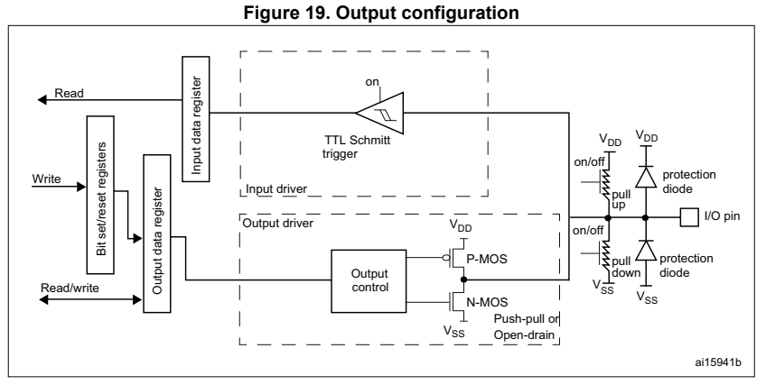  

#### 8.3.11 대체 기능(Alternate function) 구성
I/O 포트가 대체 기능으로 설정된 경우:
   * 출력 버퍼는 오픈 드레인(open-drain) 또는 푸시-풀(push-pull) 방식으로 구성할 수 있습니다.
   * 출력 버퍼는 주변 장치(peripheral)에서 오는 신호(송신기 활성화 및 데이터)에 의해 구동됩니다.
   * 슈미트 트리거(Schmitt trigger) 입력이 활성화됩니다.
   * 약한(weak) 풀업 및 풀다운 저항은 GPIOx_PUPDR 레지스터의 설정값에 따라 활성화 여부가 결정됩니다.
   * I/O 핀에 존재하는 데이터는 매 AHB 클록 주기마다 입력 데이터 레지스터로 샘플링됩니다.
   * 입력 데이터 레지스터를 읽으면 현재 I/O 상태를 확인할 수 있습니다.

그림 20은 I/O 포트 비트의 대체 기능 구성을 보여줍니다.

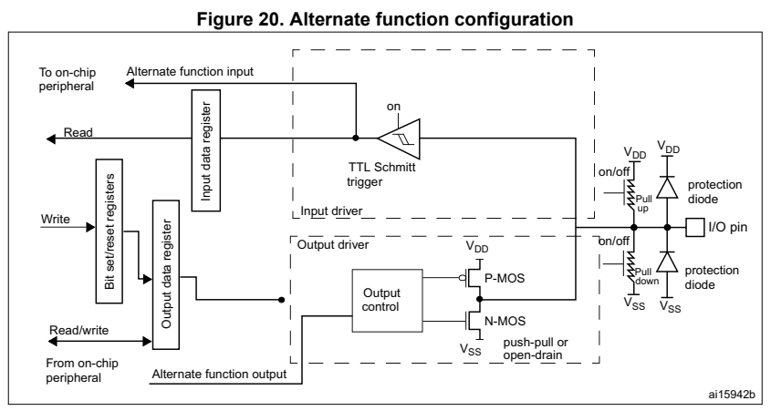  

#### 8.3.12 아날로그 구성

I/O 포트가 아날로그 구성으로 설정된 경우:
   * 출력 버퍼가 비활성화됩니다.

참고:
   * 슈미트 트리거(Schmitt trigger) 입력이 비활성화되어, I/O 핀의 아날로그 값에 관계없이 전력 소비가 발생하지 않습니다. 슈미트 트리거의 출력은 고정된 값(0)으로 강제 설정됩니다.
   * 약한(weak) 풀업 및 풀다운 저항이 비활성화됩니다.
   * 입력 데이터 레지스터를 읽으면 값 "0"이 반환됩니다.
아날로그 구성 상태인 I/O 핀은 5V 내성(5V tolerant)을 가질 수 없습니다.
그림 21은 I/O 포트 비트의 고임피던스 아날로그 입력 구성을 보여줍니다.

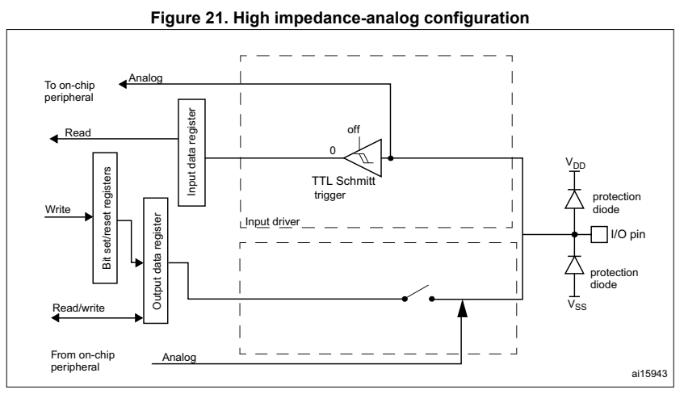  

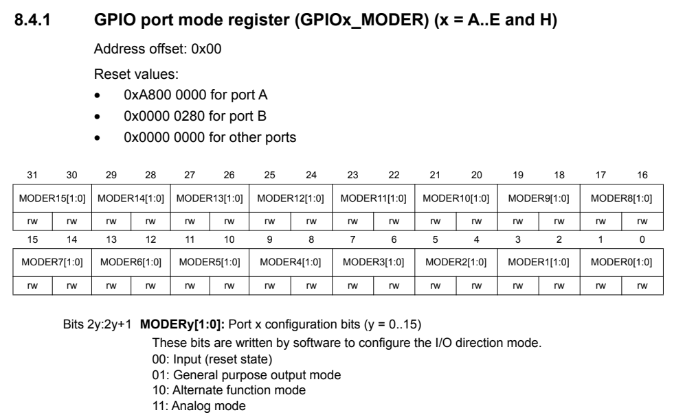  
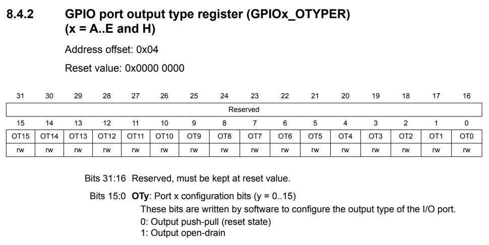  
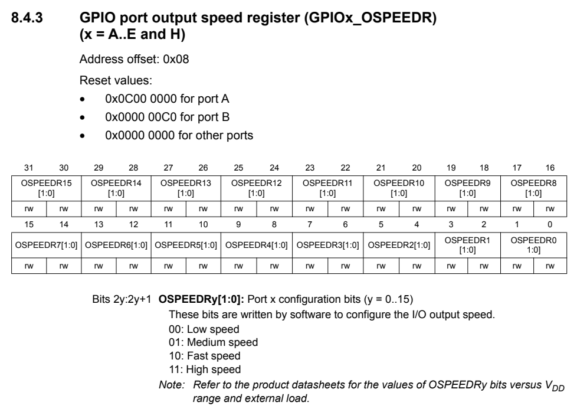  
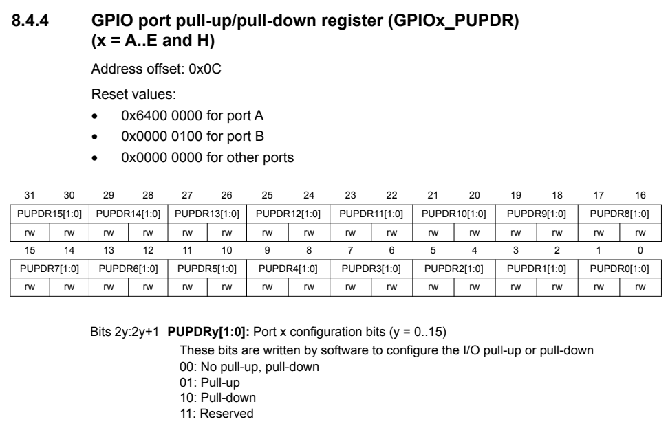  
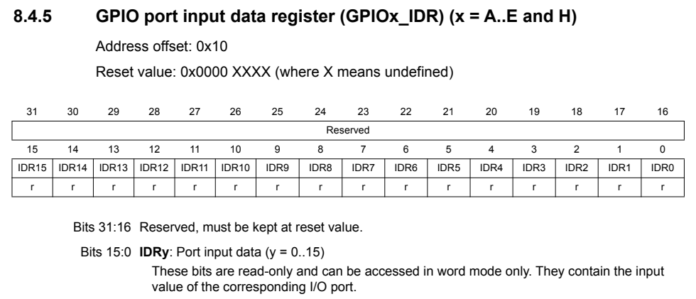  
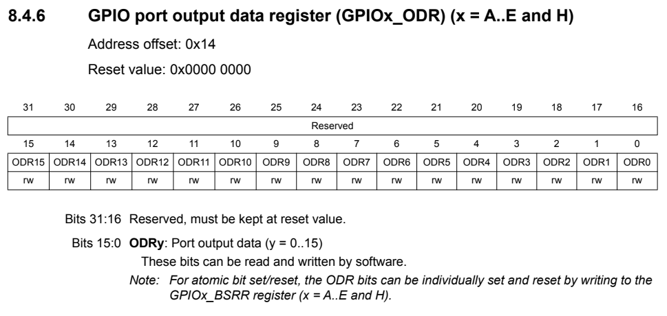  
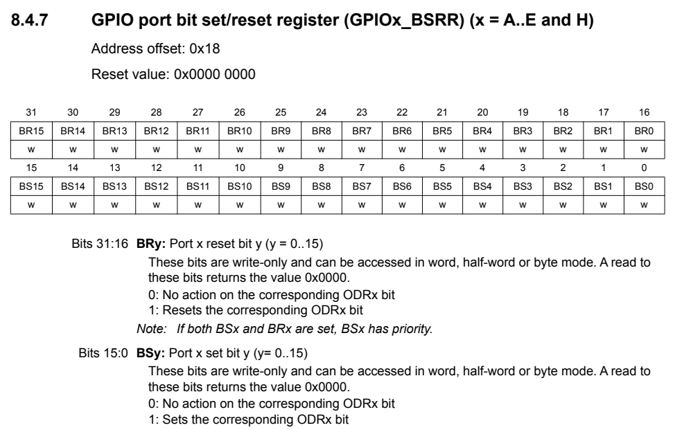  
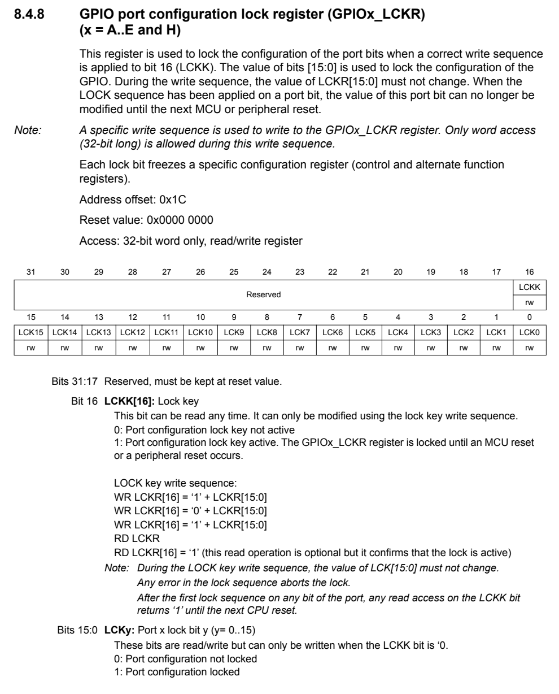  
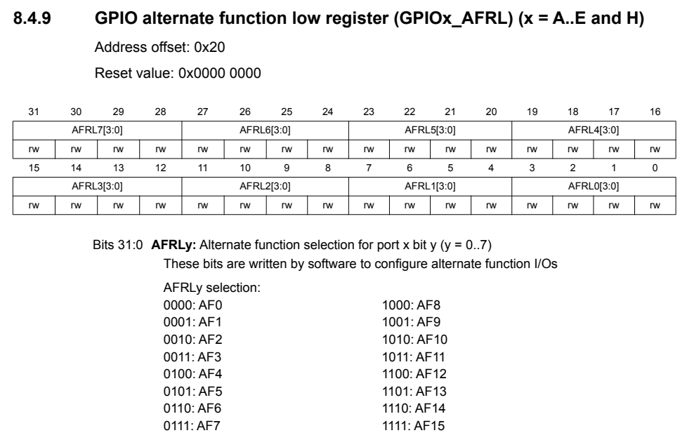  
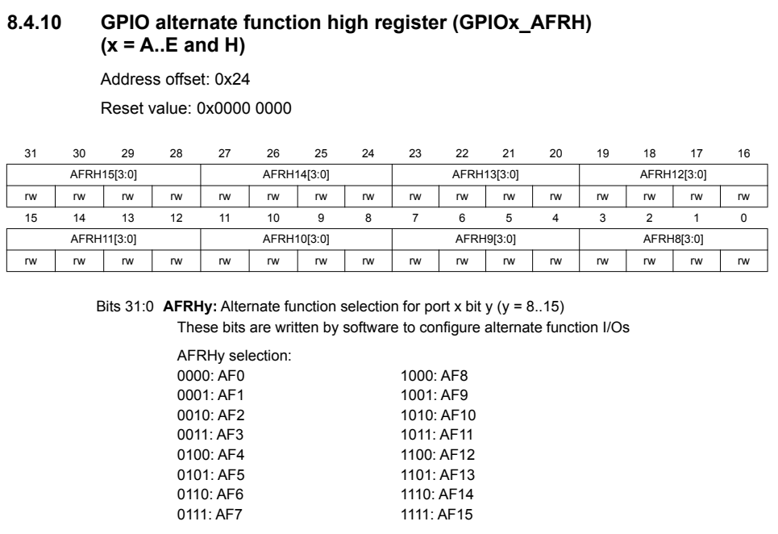  

## 5.Register

F103

  
  
  
  

## 6.Test (F103)

F103

#### 1.	LED test 프로그램을 작성합니다.
  

#### 2.	디버그를 시작합니다.
  

#### 3.	디버그 메뉴에서 실행을 시작합니다.
  

#### 4.	LD2_GPIO_Port 위에 마우스를 올리면 관련 정보들이 나옵니다.
  
  

#### 5.	GPIO A 관련 정보를 위에서 확인하면 관련 레지스터 및 주소 옵셋을 확인할 수 있습니다. 
  

#### 6.	메모리 값을 확인 및 접근하기 위해서 아래에서 Memory 탭을 누릅니다. 
  

#### 7.	플러스 버튼을 눌러서 관련 번지를 입력합니다. 값을 0x40010800을 입력합니다. 
  

#### 8.	오른쪽에 관련 메모리 범위와 값이 표현됩니다. 
  

#### 9.	우선은 값들의 변화를 확인하기 위해서 브레이크 포인트 부터 한단계씩 실행하면서 값의 변화를 확인합니다. 
  

#### 10.	우선은 값들의 변화를 확인하기 위해서 브레이크 포인트 부터 한단계씩 실행하면서 값의 변화를 확인합니다.  
#### (HAL_GPIO_WritePin(LD2_GPIO_Port, LD2_Pin, 1 실행전); 
  

#### 11.	우선은 값들의 변화를 확인하기 위해서 브레이크 포인트 부터 한단계씩 실행하면서 값의 변화를 확인합니다.  
#### (HAL_GPIO_WritePin(LD2_GPIO_Port, LD2_Pin, 0); 
  

#### 12.	우선은 값들의 변화를 확인하기 위해서 브레이크 포인트 부터 한단계씩 실행하면서 값의 변화를 확인합니다.  
#### (HAL_GPIO_WritePin(LD2_GPIO_Port, LD2_Pin, 0);    
  

#### 13.	C-F 위치의 레지스터에서 값을 직접 입력하면서 LED의 상태를 확인하고, 레지스터의 위치와 비교해보면서 동작시켜 봅니다. 
  

F411

디버그를 시작합니다.

#### 1.	Add Watch Expression 을통해서 "LD2_GPIO_Port"을 추가한다.
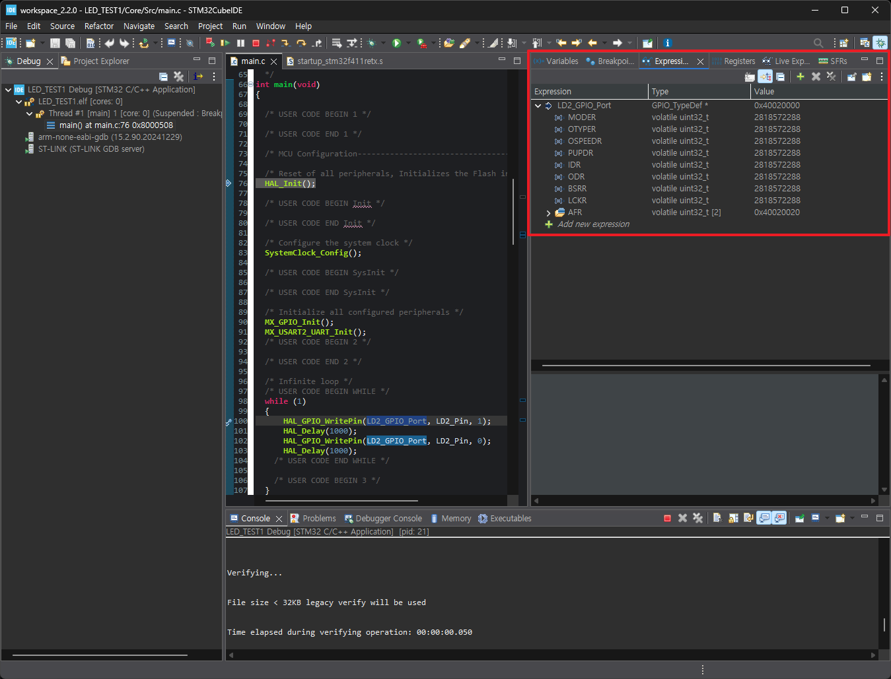  

#### 2.	SFR 레지스터를 확인합니다.
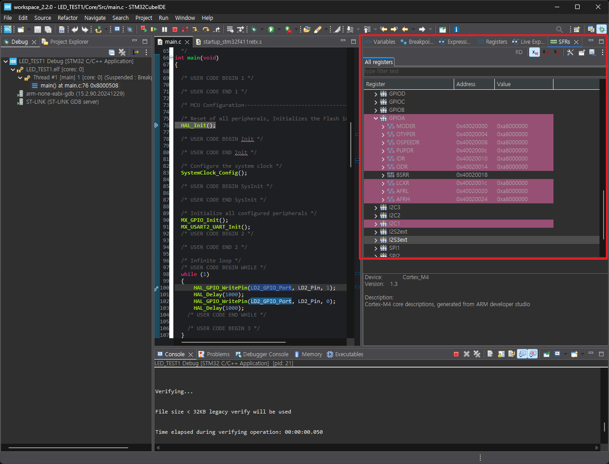  

임베디드 시스템과 마이크로컨트롤러(MCU) 세계에서 SFR은 Special Function Register(특수 기능 레지스터)의 약자입니다.

방금 우리가 이야기 나눈 MODER, OTYPER, ODR, IDR 같은 레지스터들이 바로 대표적인 SFR입니다!

SFR에 대해 핵심만 요약해 드리면 다음과 같습니다.

* 1. SFR이란 무엇인가요?
소프트웨어와 하드웨어를 잇는 다리: CPU(소프트웨어)가 MCU 내부의 주변장치(GPIO, 타이머, 통신 포트 등)를 제어하거나 상태를 읽어올 수 있도록 메모리 주소가 할당된 특별한 목적의 레지스터 공간입니다.

예를 들어, STM32에서 특정 GPIO 핀을 출력으로 만들고 싶다면 GPIOC->MODER라는 SFR 주소에 특정 값(01)을 써넣으면 됩니다. 그러면 하드웨어 회로(첫 번째 그림의 스위치와 게이트들)가 그에 맞춰 실제로 움직입니다.

* 2. 일반 메모리(RAM)와는 무엇이 다를까요?
일반 RAM: 프로그램이 실행되면서 변수를 저장하고 지우는 일반적인 작업 공간입니다.

SFR: 저장 공간이긴 한데, 이 공간에 값을 쓰거나 읽는 행위 자체가 하드웨어(회로, 핀 전압, 통신 송수신 등)를 직접 제어하게 됩니다. (이를 메모리 맵 I/O (Memory-Mapped I/O) 방식이라고 부릅니다.)

#### 3. MCU 코어의 Register 라는 정보도 볼 수 있습니다.

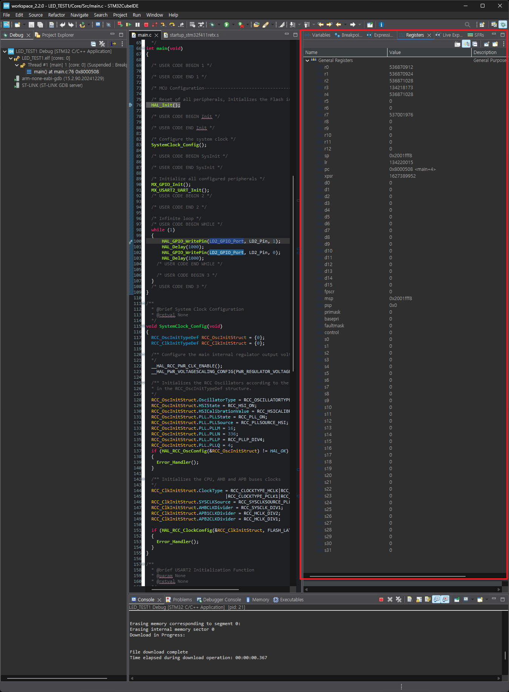  

코어 레지스터(Core Registers / General-purpose & Special Registers) 화면입니다.   앞서 살펴본 SFR(특수 기능 레지스터)이 주변장치(GPIO 등)를 제어하기 위한 "외부 부품용 제어판"이었다면, 이 화면에 나오는 레지스터들은 CPU 코어 자체가 연산을 수행하고 프로그램을 제어하기 위해 내부에 가지고 있는 핵심 작업 공간입니다.이 레지스터들의 역할과 기능, 그리고 제공해주신 HAL_GPIO_WritePin 코드(LED Blink)가 실행될 때 이 레지스터들이 구체적으로 어떻게 움직이는지 예시를 들어 정리해 드리겠습니다.1. 주요 코어 레지스터의 역할과 기능R0 ~ R12 (General Purpose Registers, 범용 레지스터)역할: 데이터 연산, 임시 값 저장, 함수 인자 전달 및 반환값 저장 등 가장 범용적으로 쓰이는 공간입니다.기능: C언어로 작성한 코드가 컴파일되면 CPU가 이해하는 어셈블리어로 바뀌는데, 이때 변수 값이나 주소값을 여기에 임시로 올려두고 계산합니다.SP (Stack Pointer, R13): MSP / PSP역할: 함수 호출 시 지역 변수나 복귀 주소를 저장하는 메모리 공간(스택)의 현재 위치를 가리키는 포인터입니다.기능: 코드가 실행되면서 함수가 중첩될 때마다 스택이 쌓이고 해제되는 위치를 기억합니다. (이미지에서 msp 값이 0x2001fff8로 지정되어 있는 것을 볼 수 있습니다.)   LR (Link Register, R14)역할: 함수가 끝난 후 다시 돌아갈 원래 위치(복귀 주소)를 기억하는 레지스터입니다.기능: 예를 들어 main() 함수 안에서 HAL_Delay() 함수를 호출하러 갈 때, "일이 끝나면 다시 main의 이 자리로 돌아와야 한다"는 주소를 LR에 저장해 둡니다.PC (Program Counter, R15)역할: CPU가 현재 실행하고 있는 명령어의 메모리 주소를 가리킵니다.기능: 이미지를 보면 pc 값이 0x8000508 <main+4>로 되어 있는데, 이는 현재 CPU가 플래시 메모리의 0x8000508 번지에 있는 기계어 명령어를 읽어서 실행하고 있음을 뜻합니다.   D0 ~ D15, S0 ~ S31 (FPU / SIMD Registers)역할: Cortex-M4 코어에 내장된 FPU(부동소수점 연산 장치)를 위한 레지스터입니다. 소수점 연산(float, double)을 할 때 사용됩니다.2. 제시해주신 코드(HAL_GPIO_WritePin) 동작 시 레지스터들의 작동 예시제시해주신 코드는 1초 간격으로 LED를 켜고 끄는 반복문입니다.   C  while (1)
  {
	  HAL_GPIO_WritePin(LD2_GPIO_Port, LD2_Pin, 1);
	  HAL_Delay(1000);
	  ...
  }
이 코드가 한 줄씩 실행될 때 코어 레지스터들이 어떻게 상호작용하는지 단계별 예시로 살펴보겠습니다.① PC (Program Counter)의 이동CPU는 while(1) 루프 내부의 명령어들을 순차적으로 실행합니다. 이때 PC 값은 실행할 명령어의 주소에 따라 계속 바뀝니다. HAL_GPIO_WritePin 함수를 호출하는 순간, PC는 해당 함수가 저장된 플래시 메모리 주소로 점프합니다.② LR (Link Register)의 백업main() 함수에서 HAL_GPIO_WritePin() 함수로 점프하기 직전, CPU는 "함수 처리가 끝나고 돌아올 복귀 주소(main의 다음 줄 주소)"를 자동으로 LR 레지스터에 저장합니다. 함수가 끝나면 PC에 LR의 값을 다시 덮어써서 main으로 안전하게 돌아옵니다.③ R0 ~ R3 (함수 인자 전달)C언어 함수인 HAL_GPIO_WritePin(LD2_GPIO_Port, LD2_Pin, 1)을 호출할 때, 전달해야 하는 매개변수들(포트 주소, 핀 번호, 출력할 값 1)은 범용 레지스터 R0, R1, R2 등에 나누어 담겨 함수 내부로 전달됩니다.④ SFR(특수 기능 레지스터)과의 최종 만남HAL_GPIO_WritePin 내부 코드가 실행되면, 전달받은 인자들을 바탕으로 앞서 이야기했던 GPIO의 ODR(Output Data Register) 같은 SFR 메모리 주소에 실제 값(1 또는 0)을 쓰게 됩니다.그 결과, MCU 내부의 하드웨어 회로(첫 번째 이미지의 ODR과 출력 드라이버)가 반응하여 실제 핀 전압이 High(1) 또는 Low(0)로 바뀌고, 연결된 LED(LD2)가 켜지거나 꺼지게 됩니다.💡 한눈에 보는 요약Core Registers (방금 보신 이미지): CPU가 코드를 실행하고, 함수를 호출하고, 연산을 처리하기 위해 사용하는 CPU 내부의 두뇌 작업 공간입니다.   SFR (앞서 이야기한 MODER, ODR 등): CPU가 주변장치(LED가 연결된 GPIO 핀 등)를 제어하기 위해 외부(메모리 맵)에 마련해 둔 하드웨어 제어판입니다.동작 흐름: CPU가 Core Register를 이용해 계산하고 명령을 내려 SFR의 값을 바꾸면, 그에 따라 핀의 물리적 상태가 변합니다.

#### 4.	하단의 Memory 에서 "0x40020000" 을 통해서 GPIO A의 레지스터 값을 볼 수 있다.
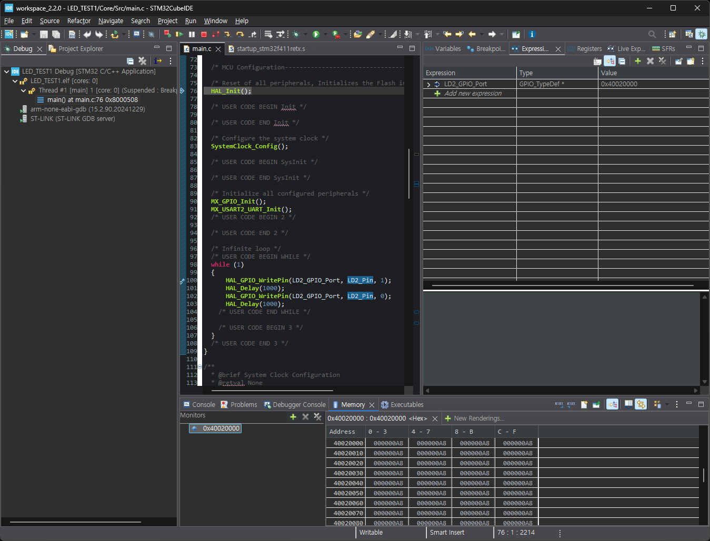  

#### 5.	HAL_Init(); 실행
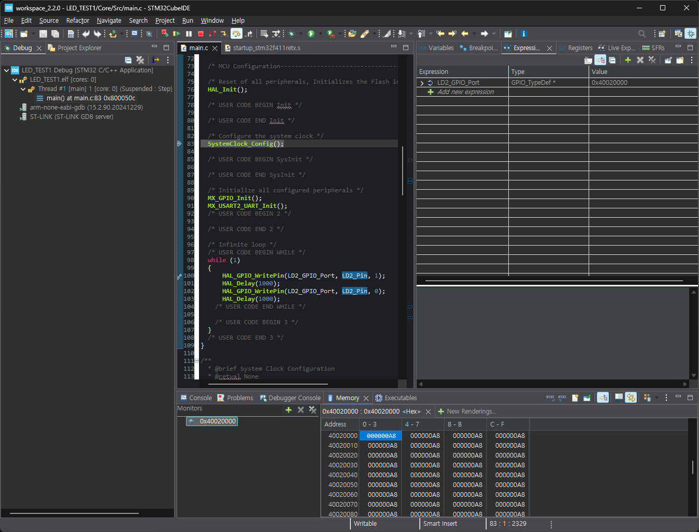  

#### 6.	SystemClock_Config(); 실행
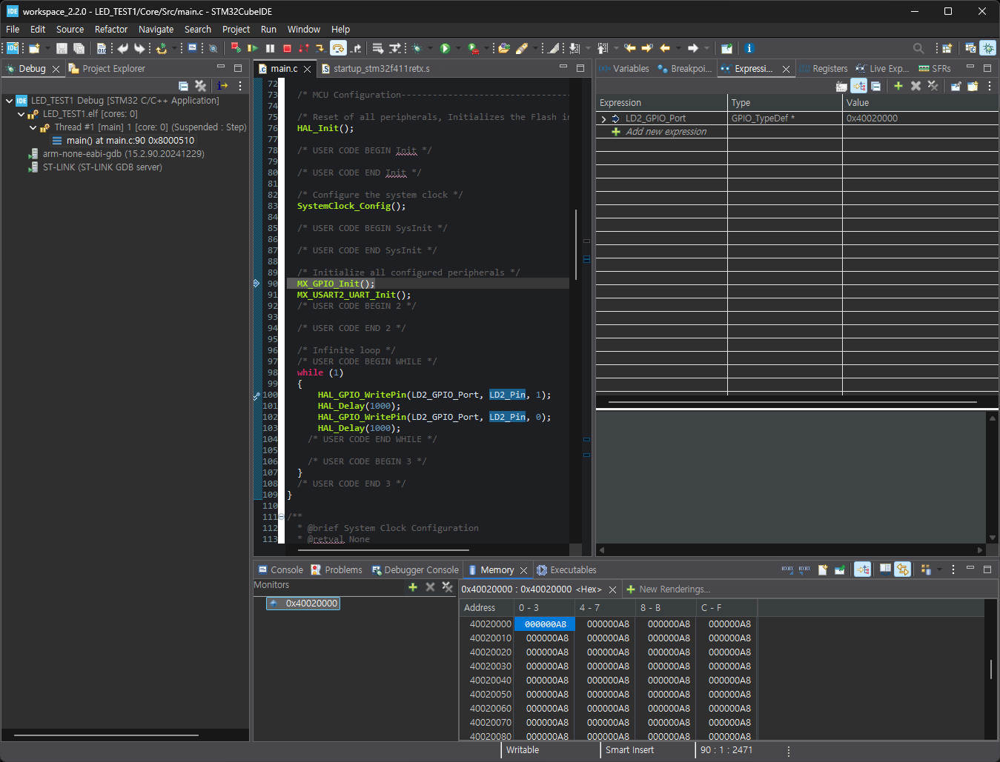  

#### 7.	MX_GPIO_Init(); 실행
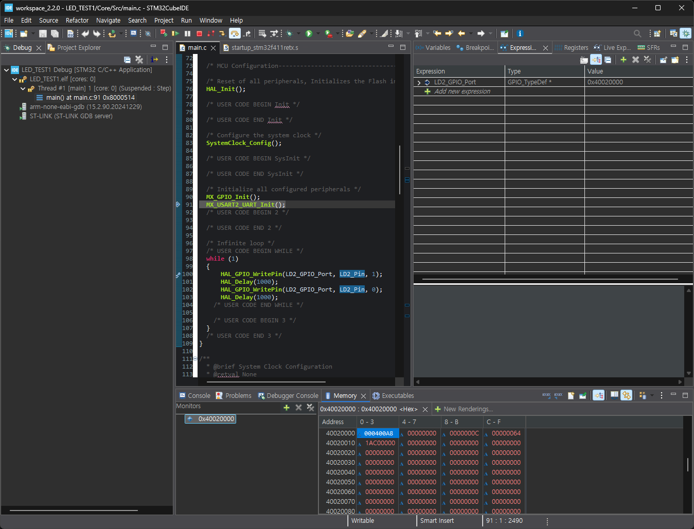  

#### 8.	MX_USART2_UART_Init(); 실행
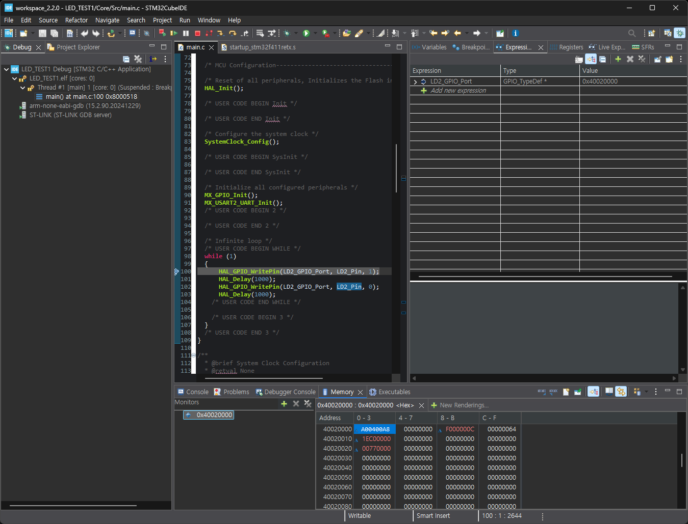  

#### 9.	HAL_GPIO_WritePin(LD2_GPIO_Port, LD2_Pin, 1); 실행
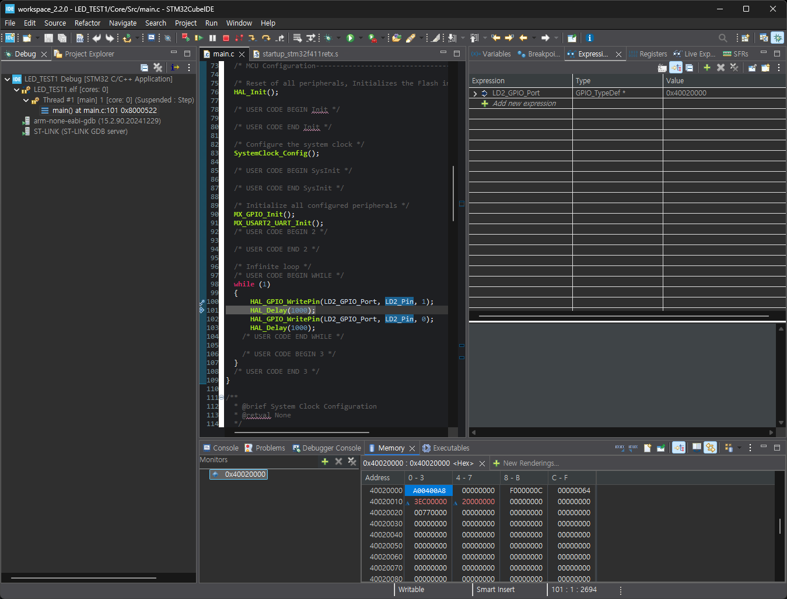  

#### 10. HAL_Delay(1000); 실행
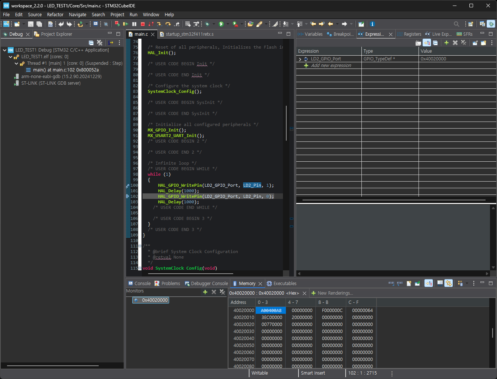  

#### 11. HAL_GPIO_WritePin(LD2_GPIO_Port, LD2_Pin, 0);  
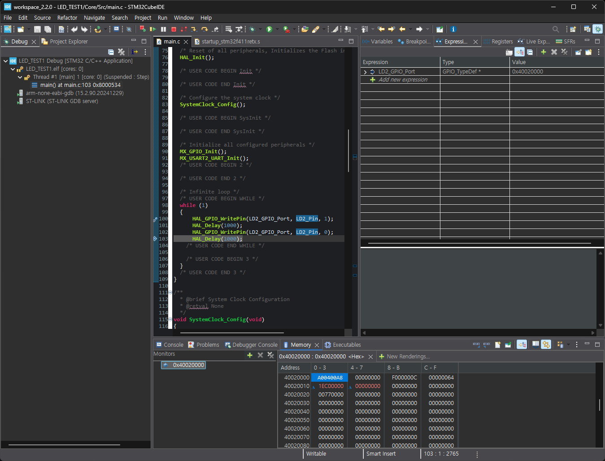  

#### 12. HAL_Delay(1000); 실행
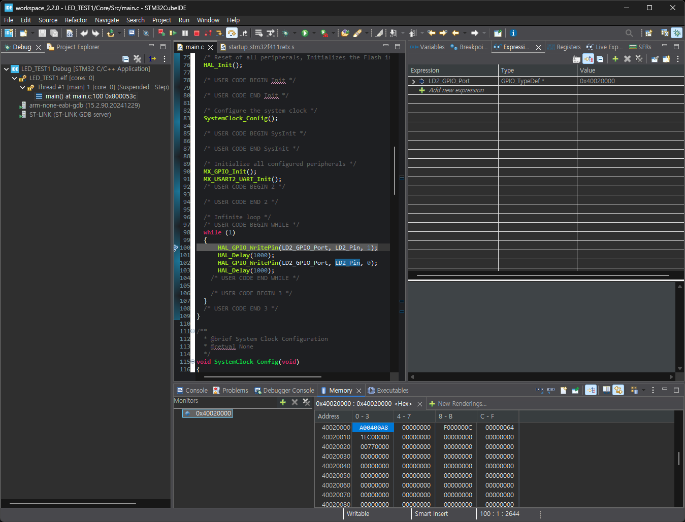  

